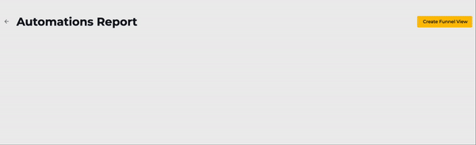

# Automation Report

## Accessing Automation Report

Based on the automation you build, you can create automation report to track the progress.&#x20;

## Step 1: Enable Report

Before creating an Automation Report, you must enabled the report for a particular Action Node. To do this, go to any Action Node and enabled the Report button. Then, set a name for this report. Click **Update Node** once done.

<figure><figcaption></figcaption></figure>

Enabling this report allows Seampify to track which contact has triggered this specific Action Node.

## Step 2: Create Funnel View

Once you have done enabled reporting for all the Action Node that you wish to track, click on the  button to go to the **Automation Funnel Report** window.

<figure><figcaption></figcaption></figure>

Then, click on the  button. Then, define a name for your Report.

<figure><figcaption></figcaption></figure>

This will open the **Create** **Automation Report** window. Here, you will see the full list of all the Events with the name you set under the Enabled Report section earlier. Drag the event you wish to track and drop at the panel on the right.

<figure><figcaption></figcaption></figure>

Once done, it will look something like the below. Click  button on top right once satisfied.

<figure><figcaption></figcaption></figure>

## Step 3: View Report

Go back to the Automation Funnel Report window and you will see the newly created Automation Report. You may click into it to view the real-time report.

<figure><figcaption></figcaption></figure>

You can filter by Date Range on the top right menu.

<figure><figcaption></figcaption></figure>

Click on the  **download button** to download the unique users' database captured within the selected date range as a CSV file to your device.

<figure><figcaption></figcaption></figure>

Click on the **Automations Funnel Reports** word on top left to go back to the Automation Funnel Report window or the **Automations** word to go back to the Automation module.

<figure><figcaption></figcaption></figure>
