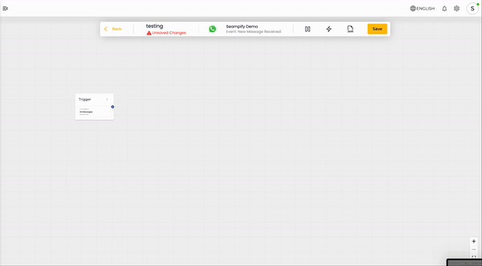
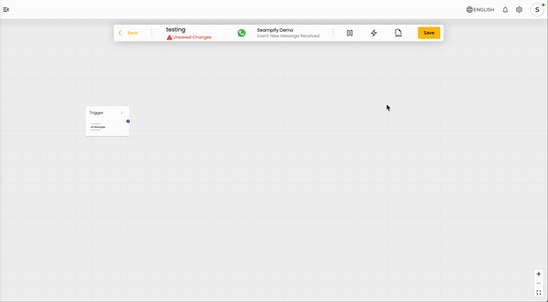
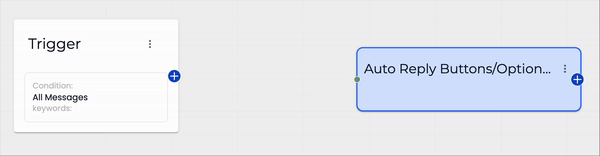

# Create a New Automation

## Step 1: Setup Automation Workflow

To create an automation workflow from scratch, click the **Add New Automation** button.

<figure><figcaption></figcaption></figure>

This will open the Create Automation Workflow modal with the options as -

* Automation Name
* Channel / Service Integration (trigger dependent)
* [Trigger Event](events.md)

<figure><figcaption></figcaption></figure>



### Define a Name

In the Create Automation Workflow modal, first, you need to define a name for the automation.&#x20;



### Select Channel

Then, select a Channel from the available options.

<figure><figcaption></figcaption></figure>




### Select Event

After selecting the Channel, you need to pick an Event to trigger the automation.&#x20;

<figure><figcaption></figcaption></figure>

If you have integrated with marketplace, you will see more options here. By default, you will see these options:

* **New Outgoing Message** - Automation is triggered when you or your teammate send a message to the contact using Chat.
* **New Incoming Message** - Automation is triggered when you receive a message on the selected Channel.
* **User Lands on Bot (Welcome Event)** - Automation is triggered when a contact start a chat with your business.
* **New Incoming Message From New Contact** - Automation is triggered when you receive a message from a new contact for the first time.
* **Conversation Closed** - Automation is triggered when you or your teammate changes the conversation status to "Closed."
* **When A Tag is Added** - Automation is triggered when you add a tag to a contact.
* **When A Tag is Removed** - Automation is triggered when you remove a tag from a contact.
* **Webhook Received** - Automation is triggered when a webhook is received on the selected channel.&#x20;

Each Event has a different set of conditions. Learn more about [Events](events.md) and [Trigger Conditions](trigger-conditions.md) in the next step.



### Click Create

Select  button once done.



## Step 2: Building a Workflow

Once you have setup the Automation Workflow settings, you will goes to the Automation window. By default, each automation will have one Trigger node.

<figure><figcaption></figcaption></figure>


Click the   **pause button** to deactivate the automation while building it. This ensures the automation won’t accidentally trigger before it’s ready.




### Set Trigger Node

Double click on the Trigger node to open its settings on the right. Simply select the required Trigger Condition and update node.

<figure><figcaption></figcaption></figure>

Based on your selected Event in step 1, you get the list of Trigger Conditions. [Learn more about list of Trigger Conditions for each event here](events.md#trigger-types).



### Add Steps

To add Workflow Steps, click the  **lighting button** to access Action types. This will open the Workflow Steps modal with all the step types. Simply select your desire Action nodes from the list and drag and drop to the workflow window.&#x20;

<figure><figcaption></figcaption></figure>


You may also right click on the window to access Action types on the left.


To learn how each step works and what's the best way to configure them, visit [Action Steps.](actions-steps.md)



### Setup Action Step

Double click on the Action nodes to open its settings on the right. Fill up the settings and click **Update Node** once done.

<figure><figcaption></figcaption></figure>



### Connect Action Step

Connect the Action nodes by clicking on the  button on the right and dragging it to the green dot  on the left of the Action nodes.

<figure><figcaption></figcaption></figure>




### Add More Action Step

To add more Action nodes, repeat the steps and choose the desire Action nodes from the list and drag and drop to the workflow window.&#x20;



### Click Save

Once your workflow is done, click on the  button.


Remember to click the  button to activate the Automation.&#x20;

It is recommended to test your Automation before publishing. [Learn more here](testing-your-automation.md)



