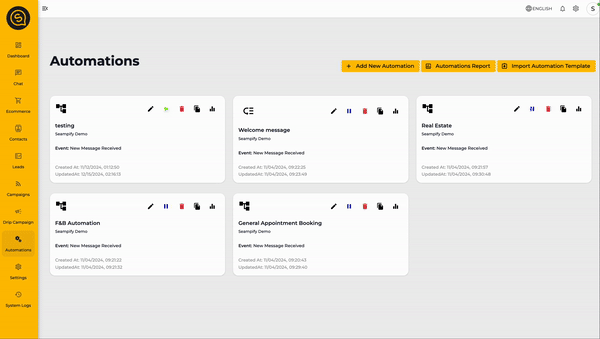

# Import Automation Template



Seampify offers a pre-built automation workflow library that’s ready to use. To access the library, simply click the **Import Automation Template** button.

<figure><figcaption></figcaption></figure>

Select the category you wish to filter from the left filter bar. Then, click on the **Preview** button for the pre-built automation workflow you'd like to view.

<figure><figcaption></figcaption></figure>

For demo purposes, we shall share a guide on how to import one of the template - Broadcast Subscription Automation below:

## Setting Up Broadcast Subscription Automation From Automation Template

Meta recommends adding an unsubscribe option to your contact list. To do this, you can use the **Opt In/Opt Out** pre-built automation workflow. This automation will automatically remove a contact from your future broadcast list when they reply with a specific keyword.

<figure><figcaption></figcaption></figure>

Click on the Preview to load the pre-built automation workflow. You may double click on any Action Node to edit the details. Else, you may just click on the  button.

<figure><figcaption></figcaption></figure>

Then, fill up the Automation Name and select the Channel. Remain the Event as New Incoming Message. Click **Save** once done and this Automation has successfully imported to your Seampify account.

<figure><figcaption></figcaption></figure>

Lastly, remember to click the  button to activate it.

<figure><figcaption></figcaption></figure>

It is always recommend to test your Automation to ensure everything is okay. To test this, simply send the keyword of **STOP** to your number and you will received an auto reply message accordingly.


This Automation will mark the contact as blacklist once they have sent in the keyword. Once a contact is marked as blacklisted, all automations and broadcast messages via Campaigns or Drip Campaigns will no longer run for that contact.

If you wish to unmark a contact from blacklist, you will need to do this manually from Contact module. [Refer here to unblock a contact.](../../contacts/contact-database.md#block-unlock-a-contact-s)

