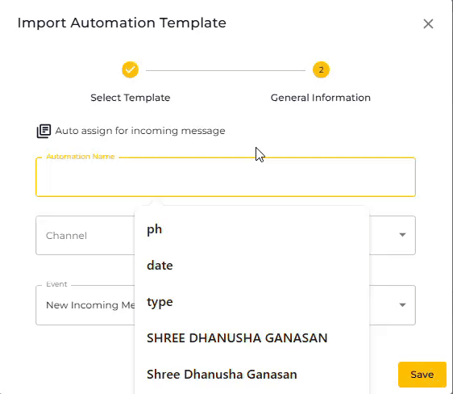
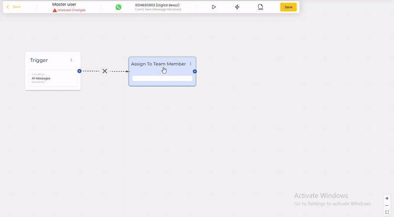

# Auto assignment to User

To receive sound notifications for new incoming messages on desktop, you need to first assign the conversation to yourself. With Seampify, you can set up automatic assignment of incoming messages to specific users by following the steps below.


For Master User, you will need to assign the conversation to yourself to receive sound notifications on desktop and message notifications on the mobile app.


## Steps to Auto Assign to User

1. Navigate to the Automation section.
2. Click on the option to import an automation template.

<figure><figcaption></figcaption></figure>

3. Navigate to the 'General' .
4. Search for the template titled "**Auto assign for incoming message**"
5. Once found, click the "Preview" button to review the template.

<figure><figcaption></figcaption></figure>

6. Click on "  " to add the template to your automation settings.

<figure><figcaption></figcaption></figure>

6. Enter a name for the automation and select the desired channel for message assignment.
7. Click "Save" to save your template.

<figure><figcaption></figcaption></figure>

6. Double-click on the "Assign to Team Member" node in the automation workflow.

*   Under **Assignment Type**, select from the following options:

    **Option A: Assign to Specific Team Member**

    * Choose a team member from the list.
    * Ideal for routing to one person.

    **Option B: Assign One by One (Round Robin Method)**

    * Assigns evenly among users with the selected **Role**.
    * You must define roles under **Settings > Roles**.

    **Option C: Assign Department wise (Round Robin Method)**

    * Assigns conversations to users in a selected **Department**.
    * Make sure you’ve set up Departments in **Settings > Departments**.

    **🆕 New Feature (for Department-wise Round Robin):**

    * **☑ Push Chat into Department Queue if Agent is not Available**
      * If no agents are online, the conversation is placed in the department queue.
      * This ensures the message isn't lost and will be picked up once an agent is available.
    * **☑ Force Reassign Even If Already Assigned**
      * Reassigns chat even if it was previously assigned.

6. Click "**Update Node"** to apply the changes.
7. Click ".png>)" to ensure all changes are saved
8. Make sure the automation is active by clicking the ".png>)" button if it is currently paused.
