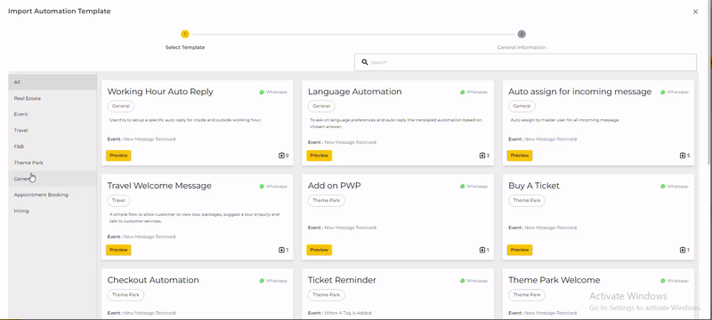
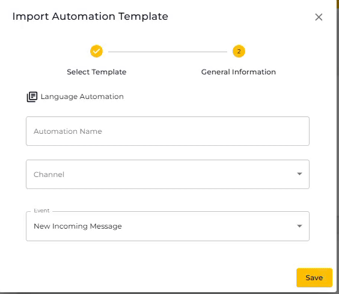
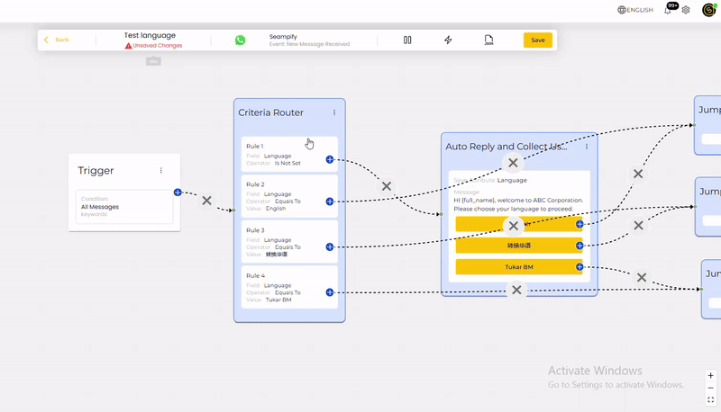
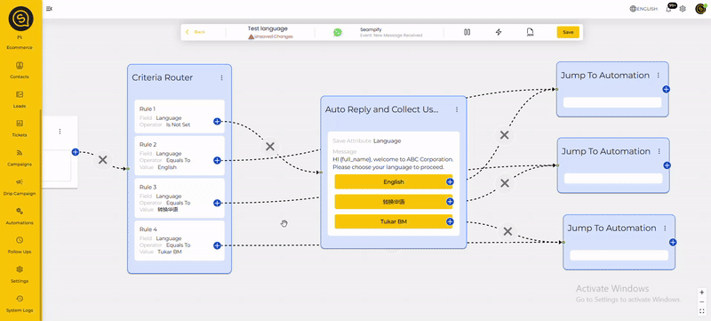
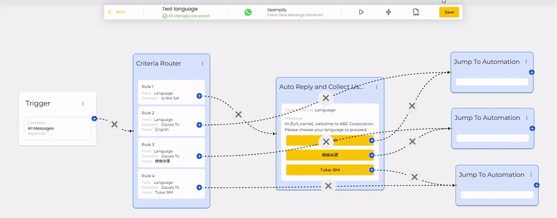

# Language Automation

This guide will help you understand and use the Language Automation template for language selection and auto-replies. The automation ensures that users receive messages in their preferred language (English, Chinese, or Malay) and get the appropriate responses based on their selection.

## Understanding the Automation Workflow

<figure><figcaption></figcaption></figure>

The automation consists of the following key components:

#### 1. **Trigger Node**

* Detects incoming messages from users.
* Initiates the workflow by checking if the language is set.

#### 2. **Criteria Router**

* Checks if the user has a saved language preference.
* If **language is set**, it redirects to the corresponding language flow.
* If **language is not set**, it proceeds to the language selection prompt.

#### 3. **Auto Reply & Language Selection**

* Sends a message asking the user to choose a language.
* Options: **English, Chinese, Malay**.
* Waits for the user’s response.

#### 4. **Jump to Automation Nodes**

* Redirects users to the appropriate response flow based on their language selection.
* The system will store the chosen language for future interactions.

## Setting Up the Automation

Step 1: Accessing the Automation Template

* Navigate to the `Automation` section.
* Click on "`Import Automation Template`"
* Click on "`Preview"` to customize the workflow.

<figure><figcaption></figcaption></figure>

#### Step 2: Import Automation Template

* Click "`Import`" to save it to your system.
* Then, type the "`Automation Name"`
* Choose "`Channel`"
* Then, click "`Save`"


There's no need to edit the Event section.


<figure><figcaption></figcaption></figure>

#### Step 3: Customizing the Messages

1. Double click on the `Trigger Node`.

You can refer here for the [Trigger Conditions](../create-a-new-automation/trigger-conditions.md) that you can use based on preference

<figure><figcaption></figcaption></figure>

2. Edit the criteria router accordingly. you can add/delete the language options.&#x20;

<figure><figcaption></figcaption></figure>

3. Double click the Auto Reply and Collect User Inputs node to edit the message as preferred.

<figure><figcaption></figcaption></figure>

4. Then choose the automation accordingly in the `Jump Automation` and click "Update Node".

<figure><figcaption></figcaption></figure>


You will need to build the translated automation first.&#x20;


#### Step 4: Activate the Automation

1. Once satisfied with the setup, click **Save** then **Play**.

<figure><figcaption></figcaption></figure>

## Troubleshooting Common Issue

* **Issue: Users not receiving language selection prompt?**
  * Ensure the **Criteria Router** is correctly checking the language attribute.
* **Issue: Wrong language responses?**
  * Verify the **Jump to Automation** nodes are correctly linked.
* **Issue: Repeated language selection prompts?**
  * Check if the user language preference is being stored properly.


You may also contact Seampify Support if you are not able to troubleshoot the issue.

