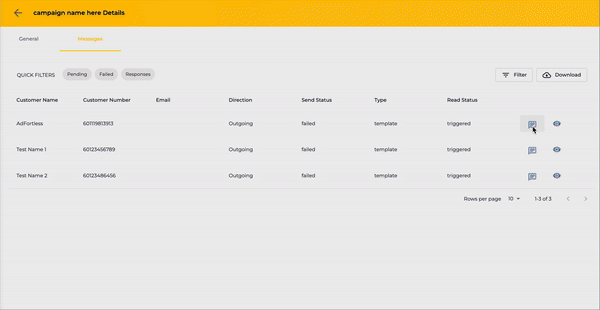
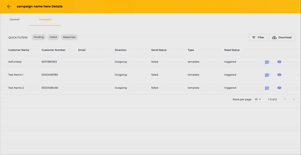

# Campaign Details & Report

To check how your campaign performed, click the **See Details** button.

<figure><figcaption></figcaption></figure>

This will open the Campaign Details window where you can view General and Message details.

## Campaign General Details

<figure><figcaption></figcaption></figure>

In the General Details window, you can view the Total number of Contacts Selected, Messages Sent, Received, and Failed. You can also view the campaign Conversation Rate, Read, and Sent Status. Plus, check the details of when the Campaign was created, and Template were used, and who created it.

### Breakdown of the Send and Read Status

<figure><figcaption></figcaption></figure>

* **Blocklist** - These contacts are marked as blacklisted and will not receive the template message.
* **Failed** - These contacts are not blacklisted but failed to receive the template message. For this, you may scroll down to see the reason for error.
* **Not Whatsapp Number** - These contacts are not linked to a WhatsApp account.
* **Pending** - These contacts are queued and waiting to receive the template message.
* **Sent** - These contacts have successfully received the template message.
* **Delivered (double tick)** - These contacts have received and read the template message. This data depends on whether the recipient has enabled the double tick feature in their WhatsApp settings.
* **sent (single tick)** - These contacts have received the template message but have not read it. By default, all successfully sent messages will appear as a single tick.
* **Triggered** - These contacts were triggered to receive the template message but failed to do so.
* **Viewed** - These contacts have received and viewed the template message. This data also relies on the recipient’s settings for showing the double tick in their WhatsApp account.

## Campaign Message Details

<figure><figcaption></figcaption></figure>

The Messages Details window allows seeing contact details as well as their status of reading the campaign.&#x20;

<figure><figcaption></figcaption></figure>

Click on the QUICK FILTERS to see the contacts under each status.&#x20;

* Pending - These contacts are queued and waiting to receive the template message.
* **Failed** - These contacts are not blacklisted but failed to receive the template message.&#x20;
* **Responses** - These contacts have responded to your template message.

You can converse with the contact directly from here by clicking theChat button.&#x20;

<figure><figcaption></figcaption></figure>

Furthermore, view the complete detail of the message for each contact by clicking theView button.

<figure><figcaption></figcaption></figure>

In addition to these, apply filters and download the details by clicking the **Filter** and **Download** buttons, respectively.

<figure><figcaption></figcaption></figure>

## Re Run Campaign

If you wish to re run the campaign to send the failed messages again, you may click the  button.

<figure><figcaption></figcaption></figure>

## Delete a Campaign

To delete a Campaign, simply click theTrash icon under the Action column of the campaign.

<figure><figcaption></figcaption></figure>

Then click the **Confirm** button to finalise the delete.

<figure><figcaption></figcaption></figure>


It is not advisable to delete as once deleted, all messages of this campaign will be deleted permanently.

