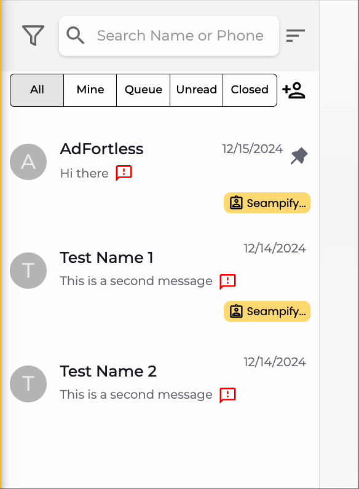

# Conversation Tray

In the Conversation Tray, you can filter chats by their status and group. In addition, you can add contacts as well as download all the chats you had with your customers.

## Filter Contacts

Select conversations to open the chat area and communicate with the contact.

<figure><figcaption></figcaption></figure>

If you wish to add a new contact, you may click  and fill in the required information. The new contact will automatically be assigned to the user who created it.

## Download Conversations

If you want to download the conversations, simply click on the contacts then click on the download button

<figure><figcaption></figcaption></figure>

