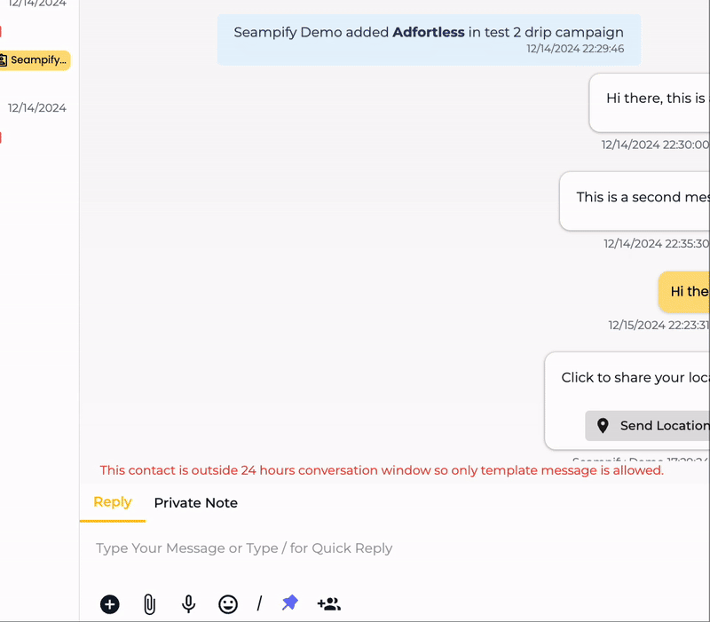
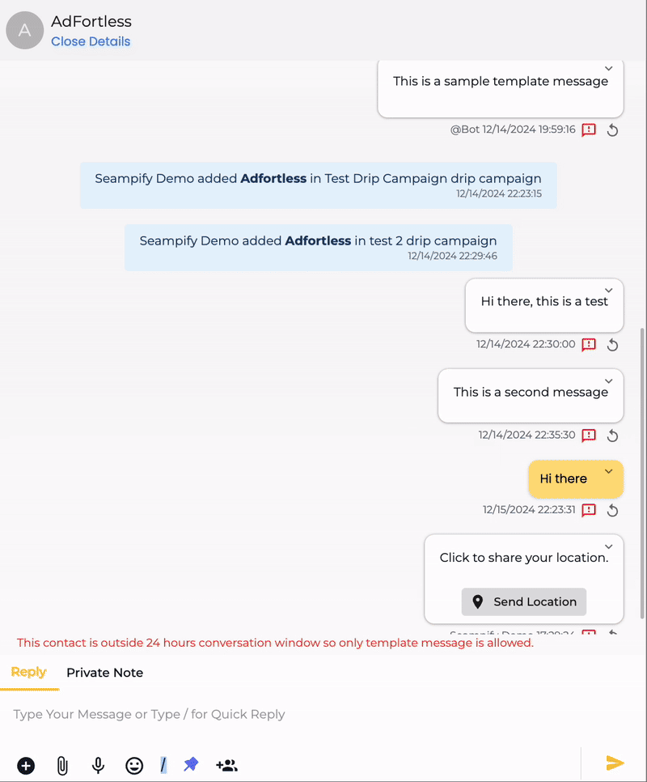

# Messaging Tools

## Reply

<figure><figcaption></figcaption></figure>

There are a few messaging tools that you are able to use to send / reply your customer:

*  More Options
  * Quick Reply
  * Send Contact
  * Send Template Message
  * Send Buttons/Flows/options/Products Message
*  Attachment
*  Record Voice
*  Emoji
*  Quick Reply
*  Pin Contact
*  Additional Chat Member

### Quick Reply 

There are 3 ways to send a quick reply, which you've created using the Quick Reply tab in Settings:

* Click the plus button icon, then select **Quick Reply**.
* Click the / button.
* Type backslash / on the messaging area.&#x20;

A popup will appear with all the quick replies created in your Seampify account. Select the one you want to send, and then click the send button

<figure><figcaption></figcaption></figure>

### **Send Contact** 

If you wish to send a contact, click the plus button icon, then select **Send Contact**.

<figure><figcaption></figcaption></figure>

This will open a Send Contact popup, fill up the information and click **Share.**&#x20;

<figure><figcaption></figcaption></figure>

### **Send Template Message** 

If you've [created template message](../settings/more-settings/channels/manage-templates/#create-a-template-messages) and want to send it, click the plus button icon, then select **Send Template Message**.

<figure><figcaption></figcaption></figure>

Then, from the Select Template popup, select the template you want to send. And once selected, click **Send**.

### Send Buttons/Options/Product Messages 

If you've [created interactive messages](../settings/more-settings/channels/interactive-messages.md#create-an-interactive-message) before using the supported channels, click the plus button icon, then select **Send Buttons/Options/Product Messages**.

<figure><figcaption></figcaption></figure>

Then from the Send Interactive Message popup, select your message and click **Send**.

### Attach File 

Using Seampify Chat, you can also send files to your customers.&#x20;

Click the attachment button icon, click **Select a file from your device**, if you want to upload a new file.&#x20;

If you've already uploaded the file using File Manager, click on the **File Manager** tab, then select the file and click **Upload**.

<figure><figcaption></figcaption></figure>

Once the file is added to the chat, click the send button

### Audio Message 

To send an audio message using Seampify Chat, click the Record Voice button icon , then from the menu that pops up, choose **Record Voice**.

<figure><figcaption></figcaption></figure>

Then click on the microphone buttonto record your voice. Once the voice is recorded, click thestop button, and click **Upload** if the recording is okay. Or your may click the **Clear** button to re-record.

Once it's uploaded, click the send button

### Sending Emoji

Through Seampify Chat, you can also use Emoticons in your messages. Simply click the emoji button icon, then select your emoji and send it.

<figure><figcaption></figcaption></figure>

## Private Notes

Here, you are also able to sent a private notes for internal communications. This will be visible to agents only. Type @ for internal tagging.

<figure><figcaption></figcaption></figure>

Once send, the message will appear in Chat Area at that point of time when you send but it is only visible for internal.&#x20;

<figure><figcaption></figcaption></figure>

The user who being tagged will received an notification on their Seampify app or desktop notification.

<figure><figcaption></figcaption></figure>
