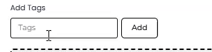

# Adding / Export Contacts

## Add New Contact 

To add a new contact, click 

<figure><figcaption></figcaption></figure>

Then, in the New Contact pop-up, enter the details as needed. And once done, click **Add** to save the contact.

## Import Contacts 

To add contacts by uploading a file, click . A modal will appear with the options to choose the Country Code, Add Tags, and Select the file. If the file already has a country code for the contacts, you can tick **Yes** under the Phone Number have country code checkbox.

<figure><figcaption></figcaption></figure>

Otherwise, select the country code that you wish to add, then add tags (if required), and add the contacts' file (CSV) from your local system. As you do that, you'll see some of your contact numbers and other details in the Preview Import. Click Data has headers if your CSV have a column header. Once you're satisfied, click Next.

\
Add a tags (if required) for all the contacts in the CSV file. Click "Add" to save the tag.

<figure><figcaption></figcaption></figure>


Kindly only upload CSV file format. You may click on the Download Sample File to view the CSV template.


<figure><figcaption></figcaption></figure>

On the next screen, ensure that all the information is assigned to the right Contact Field. By default, the column will be assigned to the respective Contact Field if it's matched, else, you may drag the column box to the correct Contact Field. If everything is correct, click **Next**.


If you need to add a new Contact Field, please do this step beforehand. You may refer [how to add a Contact Field here.](filter-options/contact-fields.md)


<figure><figcaption></figcaption></figure>

It'll take a few moments to upload the contacts, and once the process is completed, you can click **Finish**.

<figure><figcaption></figcaption></figure>

## Export Contacts

To download contacts, click the **Export** button.

<figure><figcaption></figcaption></figure>

