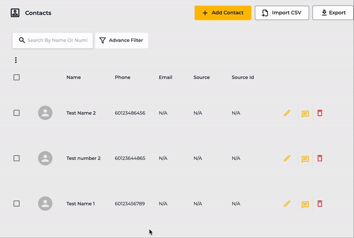
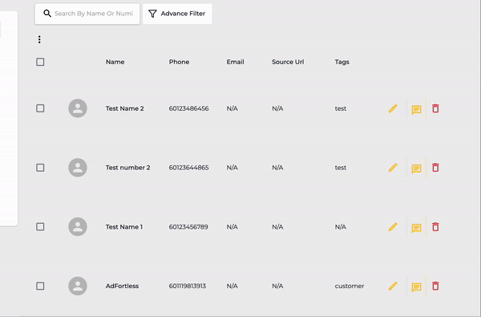
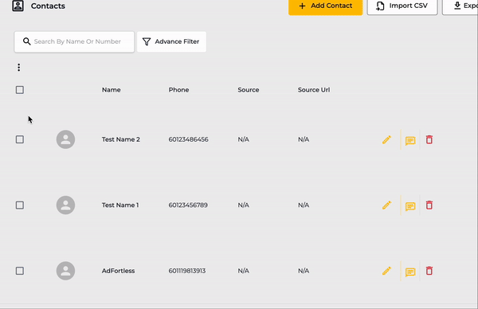

# Contact Database

## Hide/Show Columns

The columns displayed here represent all the available contact fields with the 'Show on Contacts Grid' option enabled. Click the Menu buttonthen check/uncheck which column you want to view and which doesn't.

<figure><figcaption></figcaption></figure>


If you wish to add a new column, refer [How to Add Contact Field.](filter-options/contact-fields.md#create-a-contact-field)


## Edit a Contact 

Click the Edit button Icon    to edit a particular contact.

<figure><figcaption></figcaption></figure>

Make changes to the details, and once done, click **Save**.

## Bulk Update 

<figure><figcaption></figcaption></figure>



First, select the contacts to which you want to make changes.



Then click theMore Options button, and then select **Bulk Update**.

A popup with the list of all Contact Fields available under your account will appear. If you do not have any added Contact Fields, basic options will be

* Add Tags
* Remove Tags
* Remarks

Select one from the above and make changes as required.




If you wish to add a new or edit a Contact Field, refer [Contact Field.](filter-options/contact-fields.md#create-a-contact-field)


## Chat From Contacts 

To access Chat directly from the Contacts module, click the  Chat Icon button. It will open the chat with the associate contact.

<figure><figcaption></figcaption></figure>

## Remove a Contact 

Click the Trash Button icon  associated with contact to delete it.

<figure><figcaption></figcaption></figure>

Then, click the **Confirm** button to finalise deleting.

## Bulk Remove 

First, select the contacts you want to delete. Then click theMore Options button and then click **Remove**.

<figure><figcaption></figcaption></figure>

In the Bulk Delete popup, click the **Confirm** button.

## Add to Drip Campaign


To do this, you will need to setup at least one [Drip Campaign ](../drip-campaign/create-a-drip-campaign.md)first.&#x20;




### Select Contacts

Select the contacts you want to add to the Drip Campaign.&#x20;




### Add to Drip Campaign

Click the Menu button  and then click **Add to Drip Campaign**.




### Select Campaign

Select the campaign to which you want to add the contacts, and then click **Save**.

That's it; you've added the contacts to a Drip Campaign.



Click the below to learn more about Drip Campaign.


[drip-campaign](../drip-campaign/)


## Block/Unlock a Contact(s)



To Block or Unblock a contact(s), first, select the contacts, then click theMore Options button.

From the available options, either select:

* **Block**
* Or **Unblock**.



Then click the **Confirm** button to finish the action.




