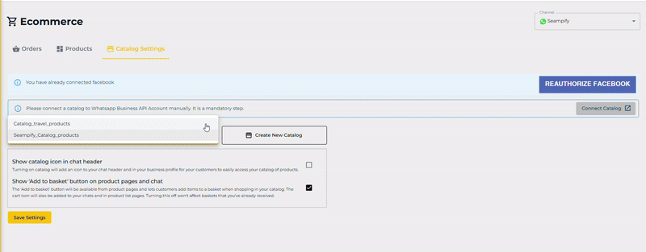

# Catalogue Settings

This guide explains how to configure your product catalog in Seampify, connect it to Facebook, and link it with your WhatsApp Business API. These steps are crucial to make your products visible to customers via chat.

### ✅ Step 1: Access the Catalog Settings Page

1. Go to **Ecommerce** from the left sidebar.
2. Click on the **Catalog Settings** tab.

<figure><figcaption></figcaption></figure>

***

### 🔗 Step 2: Authorize Meta Commerce Manager

* If you haven’t connected your Meta Commerce Manager yet, click on the **AUTHORIZE FACEBOOK TO CONNECT CATALOG** button.

<figure><figcaption></figcaption></figure>

* This opens a Facebook login popup where you can connect your Meta Commerce Manager account. Click on the **Edit previous settings** button and select **Opt in to all current and future Businesses.** Click **Continue** once done.

<figure><figcaption></figcaption></figure>


_Facebook authorization is required to sync your catalog._


***

### 🛍️ Step 3: Select or Create a Catalog

Once authorized, you will see a dropdown to select an existing catalog or click **Create New Catalog**.

* Example: `Seampify_Catalog_products`&#x20;

<figure><figcaption></figcaption></figure>

> _You can select a previously created catalog or make a new one._

* You can manage catalog names in Meta Commerce Manager.

***

### ⚙️ Step 4: Configure Catalog Display Options

You’ll see two checkbox options:

1. **Show catalog icon in chat header**\
   ➤ Adds a catalog icon in your WhatsApp Business chat window header.
2. **Show 'Add to basket' button**\
   ➤ Enables users to shop by adding products directly from the catalog to a basket.

<figure><figcaption></figcaption></figure>

✅ Recommended: Enable both options for the best shopping experience.

***

### 🌐 Step 5: Manually Connect Catalog to WhatsApp Business API

A notice will appear:

> _"Please connect a catalog to WhatsApp Business API Account manually. It is a mandatory step._

<figure><figcaption></figcaption></figure>

Follow these steps:

1. Click "**Connect Catalog**"
2. It will direct you to your WhatsApp Manager, Catalogue section.&#x20;
3. Assign your selected catalog to the correct WhatsApp number.
4. Make sure the catalog and products comply with Meta’s commerce policies.

***

### 💾 Step 6: Save Settings

* Click **Save Settings** to confirm all configurations.
* Your catalog is now live and ready to be accessed by customers through WhatsApp.

<figure><figcaption></figcaption></figure>

***

### 🧠 Reminders

* Reauthorization may be required occasionally.
* Any changes to your catalog on Meta Commerce will reflect here after synchronization.
* "Add to Basket" only works with properly configured product listings (name, price, image).
