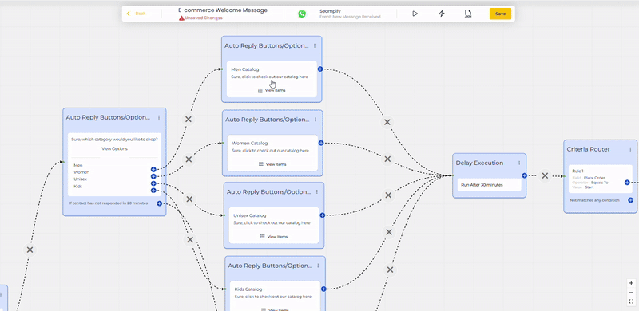
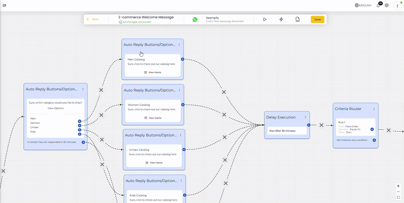

# Importing Automations for E-commerce

✅ Flow of this Automation:

When a customer messages your WhatsApp, they’re greeted with a welcome message offering options to browse products, view special offers, or talk to support. If they choose to browse, they can explore product categories from your WhatsApp Catalog and place orders directly. If they don’t respond or don’t place an order, the bot follows up after 30 minutes with a reminder and gives them the option to speak to support or end the session. If there's still no reply, the conversation is automatically handed over to a team member, ensuring a smooth and complete customer experience from start to finish. 

### ✅ **Before You Start**

📌 **Make sure your WhatsApp Catalog is already set up via Facebook Commerce Manager,** [Click to learn more on this.](catalogue-settings.md)\
📌 Add Products in [Ecommerce](products/#step-1-navigate-to-the-products-tab)**.**

## 🔧 **Step 1: Import the Automation**

1. Go to Automation > Import Automation Template

<figure><figcaption></figcaption></figure>

2. Select **E-commerce** from the template categories on the left.
3. Click on **E-Commerce Welcome Message**.
4. Click **Preview**

<figure><figcaption></figcaption></figure>

5. Click Import

<figure><figcaption></figcaption></figure>

6. Give your automation a name.
7. Choose your **WhatsApp Channel**.
8. Set the trigger to **New Incoming Message**.
9. Click **Save**.

<figure><figcaption></figcaption></figure>

## ✏️ **Step 2: Customize Your Flow**

1. **Edit the Welcome Message**

<figure><figcaption></figcaption></figure>

* Double click on this node
* Change the message text to include your **store name** and a custom greeting.
* Edit button titles:

\- “Browse Products” → “Shop Now”

\- “Special Offers” → “Weekly Deals”

\- “Talk to Support” → “Live Chat”

* Once made changes, click **Update Node** to save

2. **Edit Catalog Categories**

<figure><figcaption></figcaption></figure>

* Double-click the **Category Selection Node** (e.g., Men, Women, Kids).
* Update, rename, or remove categories as needed.
* Click **Update Node** when done.


You can only have up to 10 options in this node. If you wish to have more than 10 options, kindly contact our Support Specialist to guide you to use a WhatsApp Form or any other method.


## 🛒 **Step 3: Add Products from Your Catalog**

<figure><figcaption></figcaption></figure>

* Double click the node above to add products

<figure><figcaption></figcaption></figure>

From this node, you will see the options of Message Type as shown above. You can show your products to customer in **two ways**:

**🛍 Single Product**

* Use this if you want to show **one product only**.
* Double-click the product node.
* Select a product directly from your WhatsApp catalog.

<figure><figcaption></figcaption></figure>

**🛒 Multi-Product**

Use this to display a list of products grouped by categories.

**Steps:**

1. Double-click the **Product Node**.
2. In the message body, customize your greeting or instructions.
3. Click **Add Category (Optional)**.
4. In “Category Title,” give your section a name (e.g., “New Arrivals”).
5. Click **Add Product**.

A popup will appear — select your products from your catalog.

6. Click **Add Selected Products**.
7. Repeat for other categories.
8. Click **Update Node** when done.

<figure><figcaption></figcaption></figure>


You can have up to 30 products in a Multi-Product catalog


## Step 4: 🛠Customize the other nodes

<figure><figcaption></figcaption></figure>

1. **Customize Content & Button**

* Edit the text to match your tone and business style.
* Customize the button names, e.g.:
  * “Talk to Support” → “Chat with Agent”
  * “End Session” → “Maybe Later”

2. **Assign to a Team Member**
   1. In the last box (labeled **Assign To Team Member**), choose the team member or support role you want incoming chats to be routed to.
   2. This ensures the customer is connected to a live agent after the fallback steps.
3. **Click Save** once all editing is done and you may test your automation accordingly.

## **Step 4: Import Checkout Automation**

Once everything is done, you may want to import the E-Commerce Order Received automation so trigger a flow when customer place an order to your WhatsApp cart. Refer to the next guide for the detailed step.
