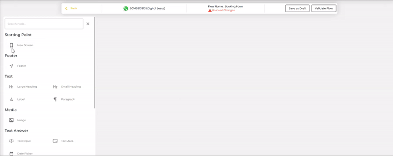
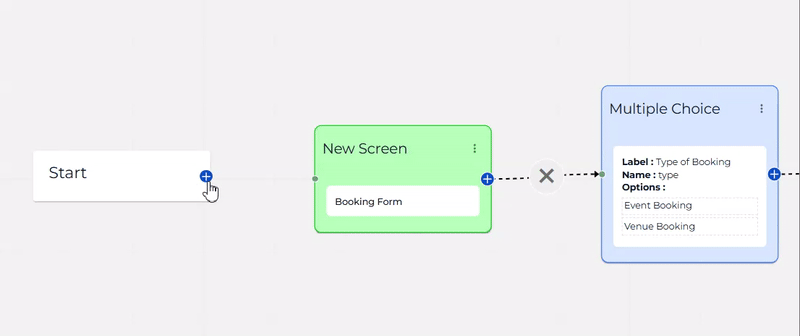
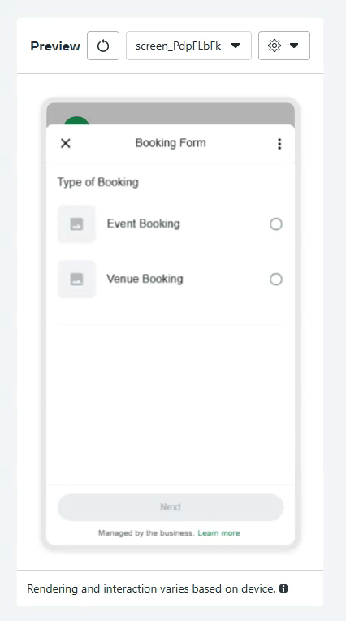
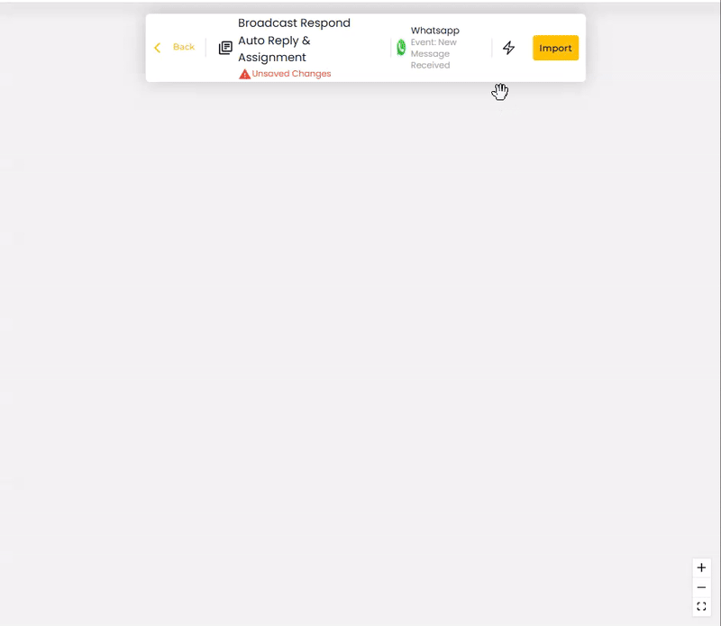

# Dynamic Flow

## What is Dynamic Flow

**Dynamic Flows** take WhatsApp Flows to the next level by enabling the creation of more complex and adaptive workflows. Unlike basic flows, Dynamic Flows allow for interactions with multiple possible outcomes and dynamically displayed information, making them ideal for advanced scenarios.&#x20;

<figure><figcaption></figcaption></figure>

By leveraging Dynamic Flows, businesses can create a secondary, customizable interface within WhatsApp. This replaces traditional two-way chat exchanges for collecting customer responses, offering a more structured and interactive experience. This approach is not only intuitive but also ensures seamless engagement, improving customer satisfaction and operational efficiency.

## How to create a Dynamic Flow

### 1. Create Whatsapp Form

1. Navigate to the **"Leads"** section from the dashboard and click on it.
2. Click the **"Create WhatsApp Form"** button.

<figure><figcaption></figcaption></figure>

3. Enter a **name** for your form to help identify it later.
4. Select **"Dynamic Flow"** from the options.
5. Click the **"Create"** button to proceed.

<figure><figcaption></figcaption></figure>

### 2. Build Your Dynamic Flow

Once your form is created, you will be redirected to the **Dynamic Flow window** where you can design your WhatsApp form.

<figure><figcaption></figcaption></figure>

Use the **drag-and-drop** functionality to add nodes based on the details you want to collect from your customers (e.g., Name, Email, Feedback, etc.).

<figure><figcaption></figcaption></figure>

### 3. Customize the nodes

1. Double-click on any node that you've dragged into the canvas to open its settings.
2. Customize the field according to your requirements:

* Define the question or prompt.
* Set the response type (e.g., text, multiple choice, number).
* Add validation rules if needed.

<figure><figcaption></figcaption></figure>

### 4. Link the Nodes

1. Connect the nodes by dragging lines between them to define the flow of the conversation.
2. Ensure the connections reflect the logical progression of the form (e.g., a user selects an option and is directed to the next question).

<figure><figcaption></figcaption></figure>

### 5.  Save your Flow

* Once the flow is built, review the structure to ensure it captures all the desired details accurately.
* Click the **"Save as Draft"** button to save your form.

<figure><figcaption></figcaption></figure>


It is advisable to click Save Draft for every step.&#x20;


### 6. Validate your Flow

1. After designing your flow, click the **"Validate Flow"** button to check for any errors or missing connections in your form.
2. Fix any issues flagged during validation to ensure the flow functions smoothly.

<figure><figcaption></figcaption></figure>

### 7. Preview your Flow

* Once validation is complete, click **"Preview"** to test your flow.
* Interact with the form as if you were a customer to ensure all nodes, connections, and responses behave as expected.
* Confirm that the flow collects all the necessary details and provides a seamless experience.


- **It is advisable to not click "Publish to WhatsApp"** until you have thoroughly reviewed and confirmed the flow.
- Once a flow is published to WhatsApp, it **cannot be edited**.


<figure><figcaption></figcaption></figure>

<figure><figcaption></figcaption></figure>

### **8. Publish Your Flow**

1. After confirming the flow meets your requirements, click the **"Publish to WhatsApp"** button.
2. Your Dynamic Flow is now live and ready to interact with customers on WhatsApp!

Once your Dynamic Flow is published, you will see the final setup and details displayed on your screen.

<figure><figcaption></figcaption></figure>

## How to Send a Dynamic Flow

Dynamic Flows can be shared with your audience through two main methods:

1. [Sending via Chat ](dynamic-flow.md#sending-via-chat)
2. [Sending via Automation](dynamic-flow.md#sending-via-automation)

### Sending via Chat&#x20;

1. Navigate to the **"Chat"** tab in your WhatsApp Business platform.
2. Select the contact you want to send the message to by clicking on their name.
3. In the chat box, click the **"+"** icon to open the message options menu.

<figure><figcaption></figcaption></figure>

4. Choose **"Send Buttons/Flows/Options/Products Message"** from the list


If a 24 Hour Customer Service window is not opened, select Send Template Message then use [Sending via Automation](dynamic-flow.md#sending-via-automation) method to send the WhatsApp form when the contact click on your template message's button.


<figure><figcaption></figcaption></figure>

5. Under **Message Type**, select **"Button/Flow."**
6. Fill in the **Body** section with a message for your customer (e.g., “Please click below to fill out the form”).
7. In the **Quick Reply Dropdown**, select **"WhatsApp Flow."**
8. Choose the specific WhatsApp Flow you want to send by selecting the name of the flow you previously saved.
9. Assign a **Label** to the button that the customer will see (e.g., “Start Form” or “Fill Details”).

<figure><figcaption></figcaption></figure>

10. Click **"Send"** to share the Dynamic Flow with the customer.
    * The customer will receive the message with the button and can interact with the flow directly in the chat.

### Sending via Automation

Dynamic Flows can be integrated into automated workflows for seamless customer interactions.&#x20;

**Steps:**

1. **Go to automation**&#x20;

* Create a new automation.
* In the automation builder, drag and drop the **Auto Reply Buttons/Options/Products** node into your flow.

<figure><figcaption></figcaption></figure>

2. **Customize the Node**

* Double-click on the node to open the right panel.
* Under **Message Type**, choose **Button/Flow**.
* Edit the message in the **Body** field to reflect what the customer will see.
* Click the **Quick Reply Dropdown** and select **WhatsApp Flow**.
* In select `WhatsApp Flow`, choose the **WhatsApp Form Name** you saved earlier in the Leads section.
* Add a **Label** to the button (e.g., “Start Form” or “Continue”).
* Click **Update Node** to save the changes.

<figure><figcaption></figcaption></figure>
