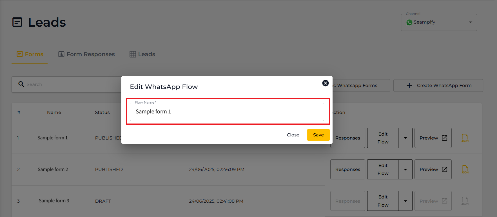
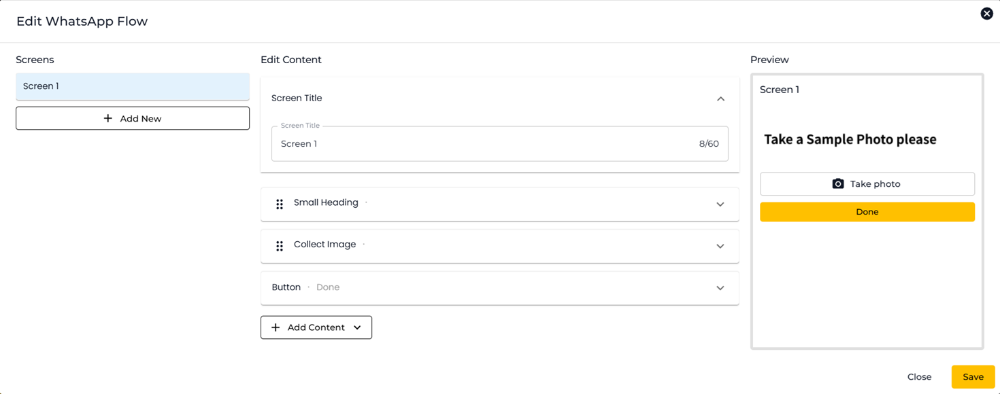

# Editing a WhatsApp Flows

You can edit published Whatsapp Flows in within Seampify. Here is a step by step guide on how to do it.

***

### Step 1: Select a WhatsApp Flows that you have published.

Forms that are published will be shown with the status "Published" and is able to click on "Responses, "Edit Flow" and "Preview" buttons.

<figure><figcaption></figcaption></figure>

### Step 2: Edit the form

Click on the "Edit Flow" button.

<figure><figcaption></figcaption></figure>

You can rename your Flow Name (WhatsApp Form Name) if needed. If not, just click "Save".

<figure><figcaption></figcaption></figure>

You can now edit the form again and once completed, click on "Save".

<figure><figcaption></figcaption></figure>

This pop up will appear here, click on "Save".

<figure><figcaption></figcaption></figure>

### Step 3: Re-publish the from

Once it saved, it will be set back to draft and you need to re-publish the form again. Just click on "Publish" and the form will good to go.

<figure><figcaption></figcaption></figure>


It is advisable to Preview your WhatsApp Flow before publishing. Once a form is being published, you are not able to delete it. However, you may depreciate a form. All responses will be still stored for depreciated forms.

