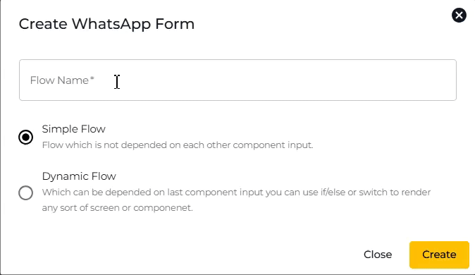
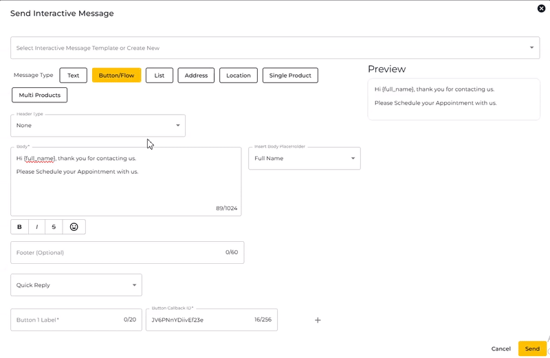

# Static Flow

Using the Static Flow, you may build a simple WhatsApp form. Here's a clearer and more concise guide for creating a static flow:

***

## **Steps to Create a Static Flow**



**Navigate to Leads**

* Go to the "Leads" section of the platform.
* Click on "Create WhatsApp Form.

<figure><figcaption></figcaption></figure>



**Create WhatsApp Form**

* Enter your desired flow name.
* Select **Simple Flow**, then click **Create**.

<figure><figcaption></figcaption></figure>



**Customize the WhatsApp Form**

* You will be directed to the Static Flow form creation page.
* Use the **Screens** section to add more page(s) if needed.
* Use the **Edit Content** section to design your form by adding features such as:
  * Date Picker
  * Multiple Choice
  * Single Choice
  * Document Upload, etc.
* The **Preview** section allows you to see how your form will look.

<figure><figcaption></figcaption></figure>



**Add Screen Title**

* Enter the desired page name in the **Screen Title** field.

<figure><figcaption></figcaption></figure>



**Add Content**

* Click **+Add Content** to include necessary form elements (e.g., date picker, multiple choice).

<figure><figcaption></figcaption></figure>


For the elements that collecting answer (e.g. Short Answer, Date Picker, Multiple Choice and others), you need to fill in the "Field Name." This is the name where the collected answer will be stored.



For **Collect Image** and **Collect Document** content, you can only choose either one per WhatsApp Flow. If you wish to use both, suggest to create 2 different flow.


<figure><figcaption></figcaption></figure>



**Save and Preview**

* Click **Save as Draft** to save your progress.

<figure><figcaption></figcaption></figure>

* The newly created WhatsApp flow will appear in the list. Preview the form to ensure everything appears as intended.

<figure><figcaption></figcaption></figure>


It is advisable to preview the form as the form **cannot be edited after publishing.**




**Edit (if needed)**

* Use the **Edit Flow** option to modify content if necessary.

<figure><figcaption></figcaption></figure>




**Publish the Form**

* Once satisfied, click **Publish** to make use the form.

<figure><figcaption></figcaption></figure>

**Note**: After publishing, the form **cannot be edited.**


**Note**: After publishing, the form **cannot be edited directly**. However, you can **clone the form** to create a new version and then edit its content.





## How to Send a Static Flow

Simple Flows can be shared with your audience through two main methods:

1. [Sending via Chat](static-flow.md#sending-via-chat)
2. [Sending via Automation](static-flow.md#sending-via-automation)

### Sending via Chat

1. Navigate to the **"Chat"** tab in your WhatsApp Business platform.
2. Select the contact you want to send the message to by clicking on their name.
3. In the chat box, click the **"+"** icon to open the message options menu.

<figure><figcaption></figcaption></figure>

4. Choose **"Send Buttons/Flows/Options/Products Message"** from the list


If a 24 Hour Customer Service window is not opened, select Send Template Message then use [Sending via Automation](static-flow.md#sending-via-automation) method to send the WhatsApp form when the contact click on your template message's button.


<figure><figcaption></figcaption></figure>

5. Under **Message Type**, select **"Button/Flow."**
6. Fill in the **Body** section with a message for your customer (e.g., “Please click below to fill out the form”).
7. In the **Quick Reply Dropdown**, select **"WhatsApp Flow."**
8. Choose the specific WhatsApp Flow you want to send by selecting the name of the flow you previously saved.
9. Assign a **Label** to the button that the customer will see (e.g., “Start Form” or “Fill Details”).

<figure><figcaption></figcaption></figure>

10. Click **"Send"** to share the Static Flow with the customer.
    * The customer will receive the message with the button and can interact with the flow directly in the chat.

### Sending via Automation

Simple Flows can be integrated into automated workflows for seamless customer interactions.

**Steps:**

1. **Go to automation**

* Create a new automation.
* In the automation builder, drag and drop the **Auto Reply Buttons/Options/Products** node into your flow.

<figure><figcaption></figcaption></figure>

2. **Customize the Node**

* Double-click on the node to open the right panel.
* Under **Message Type**, choose **Button/Flow**.
* Edit the message in the **Body** field to reflect what the customer will see.
* Click the **Quick Reply Dropdown** and select **WhatsApp Flow**.
* In select `WhatsApp Flow`, choose the **WhatsApp Form Name** you saved earlier in the Leads section.
* Add a **Label** to the button (e.g., “Start Form” or “Continue”).
* Click **Update Node** to save the changes.

<figure><figcaption></figcaption></figure>

## Components and Limitations

### Text Components

The components here are:

* Heading
* Subheating
* Body
* Caption

Example

<figure><figcaption></figcaption></figure>

#### Limits and Restrictions

| Component                                                                                            | Type            | Limit / Restriction                                                                 |
| ---------------------------------------------------------------------------------------------------- | --------------- | ----------------------------------------------------------------------------------- |
| 
Heading

 

Subheading

 

Body

 

Caption

 
 | Character Limit | 
80

 

80

 

4096

 

409

 
 |
| 
Heading

 

Subheading

 

Body

 

Caption

 
 | Text            | Empty or Blank value is not accepted                                                |

### Rich Text

Flow JSON 5.1 introduces a new component - Rich Text. The goal of the component is to provide a rich formatting capabilities and introduce the way to render large texts (**Terms of Condition**, **Policy Documents**, **User Agreement** and etc) without facing limitations of basic text components (**TextHeading**, **TextSubheading**, **TextBody** and etc)

#### Supported Syntax:

* Headings (Heading h1 and Subheading h2)
* Paragraphs
* Lists (Single Level)
* Images
  * External URIs are not supported and you can only include base64 inline images.
  * Recommended formats:
    * png
    * jpg / jpeg
    * webp (only supported from iOS 14.6)
* Links
* Tables

### Text Entry Components

The components here are:

* TextInput
* TextArea

Example:

<figure><figcaption></figcaption></figure>

#### Limits and Restrictions

| Component | Type                                            | Limit / Restriction                                          |
| --------- | ----------------------------------------------- | ------------------------------------------------------------ |
| TextInput | 
Helper Text

Error Text

Label
 | 
80 characters

30 characters

20 characters
 |
| TextArea  | 
Helper Text

Label
                  | 
80 characters

20 characters
                     |

### CheckboxGroup

CheckboxGroup component allows users to pick multiple selections from a list of options.

Example:

<figure><figcaption></figcaption></figure>

#### Limits and Restrictions

| Type             | Limit / Restriction |
| ---------------- | ------------------- |
| Label Content    | 30 Characters       |
| Title            | 30 Characters       |
| Description      | 300 Characters      |
| Metadata         | 20 Characters       |
| Min # of options | 1                   |
| Max # of options | 20                  |
| Image            | 100KB               |

### RadioButtonsGroup

Example:

<figure><figcaption></figcaption></figure>

#### Limits and Restrictions

| Type             | Limit / Restriction |
| ---------------- | ------------------- |
| Label Content    | 30 Characters       |
| Title            | 30 Characters       |
| Description      | 300 Characters      |
| Metadata         | 20 Characters       |
| Min # of options | 1                   |
| Max # of options | 20                  |
| Image            | 100KB               |

### Footer

Example:

<figure><figcaption></figcaption></figure>

#### Limits and Restrictions

| Type                         | Limit / Restriction |
| ---------------------------- | ------------------- |
| Label Max Character Limit    | 35                  |
| Captions Max Character Limit | 15                  |

### Dropdown

Example:

<figure><figcaption></figcaption></figure> <figure><figcaption></figcaption></figure>

#### Limits and Restrictions

| Type                 | Limit / Restriction                                              |
| -------------------- | ---------------------------------------------------------------- |
| Label                | 20 characters                                                    |
| Title                | 30 characters                                                    |
| Min dropdown options | 1                                                                |
| Max dropdown options | 200 if no images are present in the `data-source`, 100 otherwise |
| Description          | 300 characters                                                   |
| Metadata             | 20 characters                                                    |
| Image                | 100KB                                                            |

### Embedded Link

Example:

<figure><figcaption></figcaption></figure>

#### Limits and Restrictions

| Type                                    | Limit / Restriction                  |
| --------------------------------------- | ------------------------------------ |
| Character limit                         | 25                                   |
| Case                                    | No restriction on formatting         |
| Max Number of Embedded Links Per Screen | 2                                    |
| Text                                    | Empty or Blank value is not accepted |

### DatePicker

The DatePicker component allows users to input dates through an intuitive date selection interface.

Example:

<figure><figcaption></figcaption></figure> <figure><figcaption></figcaption></figure>

#### Limits and Restrictions

| Type                     | Limit / Restriction |
| ------------------------ | ------------------- |
| Label Max Length         | 40 characters       |
| Helper Text Max Length   | 80 characters       |
| Error Message Max Length | 80 characters       |

### CalendarPicker

The CalendarPicker component allows users to select a single date or a range of dates from a full calendar interface.

Example:

<figure><figcaption></figcaption></figure> <figure><figcaption></figcaption></figure>

#### Limits and Restrictions

| Type                     | Limit / Restriction |
| ------------------------ | ------------------- |
| Title Max Length         | 80 characters       |
| Description Max Length   | 300 characters      |
| Label Max Length         | 40 characters       |
| Helper Text Max Length   | 80 characters       |
| Error Message Max Length | 80 characters       |

### Image

Example:

<figure><figcaption></figcaption></figure>

#### Limits and Restrictions

| Type                            | Limit / Restriction |
| ------------------------------- | ------------------- |
| Max number of images per screen | 3                   |
| Recommended image size          | Up to 300kb         |
| Total data channel payload size | 1 Mb                |
| Supported images formats        | JPEG PNG            |

### Navigation List

The NavigationList component allows users to navigate effectively between different screens in a Flow, by exploring and interacting with a list of options. Each list item can display rich content such as text, images and tags.

Example:

<figure><figcaption></figcaption></figure> <figure><figcaption></figcaption></figure>

#### Limits and Restrictions

* The \`Navigation List\` component cannot be used on a terminal screen.
* There can be at most 2 \`Navigation List\` components per screen.
* The \`Navigation List\` components cannot be used in combination with any other components in the same screen.
* There can be only one item with a \`badge\` per list.
* The \`end\` add-on cannot be used in combination with \`media-size\` set to \`large\`.
* The \`on-click-action\` cannot be defined simultaneously on component-level and on item-level.

Component Restrictions:

| Property    | Limit / Restriction                                                                                         |
| ----------- | ----------------------------------------------------------------------------------------------------------- |
| list-items  | 
minimum 1 and maximum 20 items

 

Content will not be rendered if the limit is reached
 |
| label       | 
80 characters

 

Content will truncate if the limit is reached
                         |
| description | 
300 characters

 

Content will truncate if the limit is reached
                        |

List Items Restrictions:

| Add-on / property | Property                                                            | Limit / Restriction                                                                   |
| ----------------- | ------------------------------------------------------------------- | ------------------------------------------------------------------------------------- |
| start             | image                                                               | 
100KB

 

Images over the limit will be replaced by a placeholder
 |
| main-content      | 
title

 

description

 

metadata
 | 
30 characters

 

20 characters

 

80 characters
    |
| end               | 
title

 

description

 

metadata
 | 
10 characters

 

10 characters

 

10 characters
    |
| badge             |                                                                     | 15 characters                                                                         |
| tags              |                                                                     | 
15 characters

 

3 items
                                         |

### Chips Selector

Chips Selector component allows users to pick multiple selections from a list of options.

Example:

<figure><figcaption></figcaption></figure>

#### Limits and Restrictions:

| Type             | Limit / Restriction |
| ---------------- | ------------------- |
| Label            | 80 Characters       |
| Min # of options | 300 Characters      |
| Min # of options | 2                   |
| Max # of options | 20                  |

### Image Carousel 

The Image Carousel component allows users to slide through multiple images.

Example:

<figure><figcaption></figcaption></figure>

#### Limits and Restrictions:

| Type                              | Limit / Restriction |
| --------------------------------- | ------------------- |
| Min # of images                   | 1                   |
| Max # of images                   | 3                   |
| Max # of ImageCarousel per screen | 2                   |
| Max # of ImageCarousel per Flow   | 3                   |
