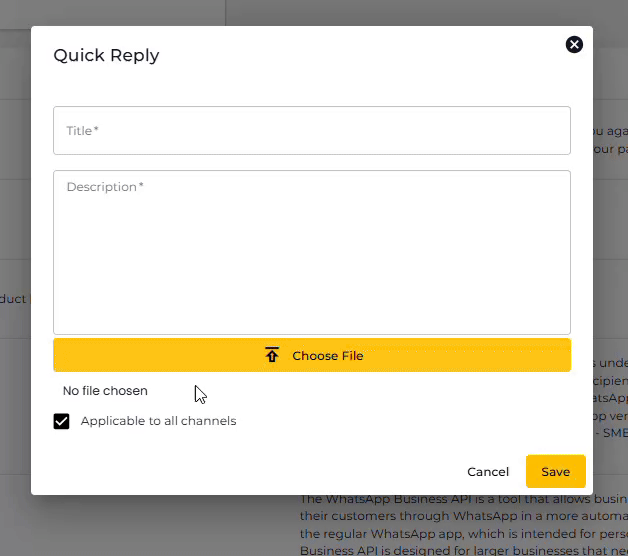
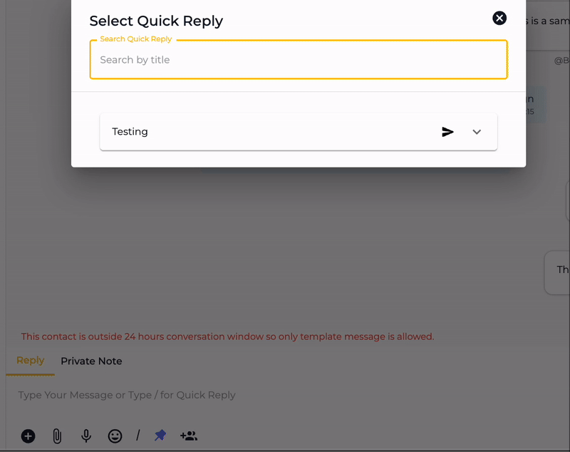

# Quick Reply

Quick replies are helpful when you don't want to send the same message over and over manually to the same or different customers. At Seampify, you can create Quick Replies and send them using Chat to save time and respond to the user quickly.

To access Quick Reply, go to **Settings** → then click on the **Quick Reply** tab.


You can save different Quick Replies for each channel.


<figure><figcaption></figcaption></figure>

## Create a Quick Reply



To create a Quick Reply, click **Create Quick Reply**.

<figure><figcaption></figcaption></figure>



Fill up the Quick Reply modal with:

* Quick Reply Title - **Enter the title**
* Quick Reply - **Enter the description**
* And **Choose File** to attach an image file (optional).
* By default, this applies to all channels. If you want to select a specific channel, click the dropdown and choose your preferred channel.

<figure><figcaption></figcaption></figure>



Input the details, add a file if you need it, and once done, click **Save**



## Edit a Quick Reply

To edit a Quick Reply, go to **Settings** → **Channels** →  then click on the **Quick Reply** tab under the Channel → then click the **Edit** icon.

<figure><figcaption></figcaption></figure>

This will open the Update Quick Reply modal. Here, you can make the changes as required to the selected Quick Reply. Once edited, click **Update**.

<figure><figcaption></figcaption></figure>

## Delete a Quick Reply

On the Quick Reply tab, click the Trash icon to delete a particular Quick Reply.

<figure><figcaption></figcaption></figure>

Then click **Confirm** to finalize deleting.

<figure><figcaption></figcaption></figure>

## Accessing Quick Reply from Chat

A Quick Reply could be used through Chat while conversing with a contact. There are 3 ways to access the Quick Reply menu from Chat:

**Method 1**

Simply click the Plus icon

<figure><figcaption></figcaption></figure>

**Method 2**

Type / on the message bar.

<figure><figcaption></figcaption></figure>

**Method 3**

&#x20;Click the / icon.

<figure><figcaption></figcaption></figure>

When you click the **Quick Reply** button, a list of saved quick replies will appear, allowing you to select the most appropriate response quickly and easily.

<figure><figcaption></figcaption></figure>

Here, you can search the Quick Reply by its title.&#x20;

Click the drop down menu to view its content. 

<figure><figcaption></figcaption></figure>

Click the **Send button**  to copy the saved Quick Reply to the message bar. Then, you may edit the message or send directly.

<figure><figcaption></figcaption></figure>
