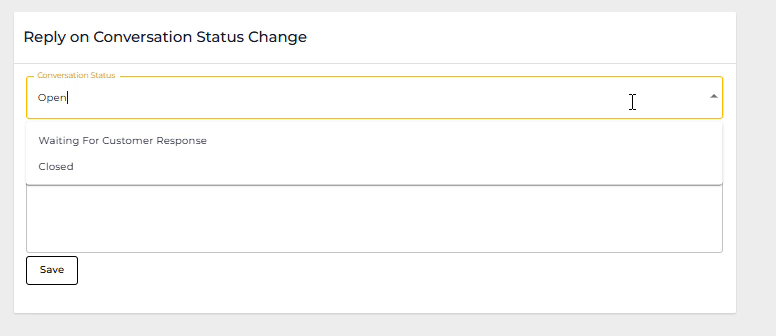

# Channel General Settings

General Settings under a channel allow you to manage the settings for that particular channel.&#x20;

To access General Settings go to **Settings** → **Channels** →  then click on the **General Settings** tab under the Channel.

<figure><figcaption></figcaption></figure>

The settings includes:

* [Chat Settings](channel-general-settings.md#chat-settings)
* [Chat Queue Settings](channel-general-settings.md#chat-queue-setting)
* [Working Hours Settings](channel-general-settings.md#working-hours)
* [Chat Assignment Settings](channel-general-settings.md#chat-assignment-settings)
* [Reply on Conversation Status Change](channel-general-settings.md#reply-on-conversation-status-change)

<figure><figcaption></figcaption></figure>

## Chat Settings

Chat Settings of Channel General Settings lets you activate the following options:

* **Assign Chat to First Replier** - If any User reply to the particular chat which comes to business, that chat will auto assign to that particular user.
* **Keep a Chat unread on click** - If any User click on an chat, the chat will not mark as read automatically. It will remain as unread unless a manual assignment of mark as read has perform.
* **Send Chat Notifications to the Managers** - When turned on, admin will also get the notification when an incoming conversation received.
* **Send Agent Name in Text Messages** - When enabled, the user's name will be sent along with their text messages. The name will appear above the messages sent by that specific user.
* **Response Wait Timer** - This feature shows how long the customer and agent have been waiting since their last message in the mid of the conversation, providing real-time wait time updates.

<figure><figcaption></figcaption></figure>

To turn on a feature, toggle the On/Off button.

## Chat Queue Setting

This setting allows you to manage your automation when a conversation has pushed to Queue. The available functions are:

* Enable automatic closing chats from the queue.
* Enable automatic closing chat from the bot.
* Enable auto assignment for queue chats.

<figure><figcaption></figcaption></figure>

When any of the option turn on, you will have more settings to close the chat and send a messages within a specific timeframe automatically.

## Working Hours Settings

To define the office hours and holidays of your business in that particular Channel, you can utilise the Working Hours setting under Channel General Settings.

Simply click the Edit icon.

<figure><figcaption></figcaption></figure>

Then, activate the days you work and mention the time.

<figure><figcaption></figcaption></figure>

If you want to declare holidays, click the Holidays field and then select the dates.

<figure><figcaption></figcaption></figure>

Once added Working Hours and Holidays, click **Apply**.

## Chat Assignment Settings

Chat Assignment Settings typically refers to the configuration options available for managing how incoming chats or messages are assigned to agents or representatives within a business or customer support system. Here's a general guide on how you might access and configure these settings:

1. **Agent Availability**: Automatically send a reply message to a chat when it is assigned to an available agent.
2. **Agent On Break** - Automatically send a reply message to a chat when it is assigned to an agent with an **Offline** status during **Working Hours**. You can also push that chat into the Department Queue when the assignment happens.
3. **Non-Working Hours Status**: Automatically send a reply message to a chat when it is assigned to an agent during **Non** **Working Hours**. You can also push that chat into the Department Queue when the assignment happens.

<figure><figcaption></figcaption></figure>

If you wish to Round Robin one-by-one to users from Automation, you need setup to which roles this rule shall be applied from here. Once set, only user having that specific role would be assigned.

<figure><figcaption></figcaption></figure>

You can set more than one role here.

## Reply on Conversation Status Change&#x20;

In Seampify, the **Conversation Status Change** feature allows you to set a default message for  the chosen conversations status.&#x20;

For example, if the conversation status is "open". This ensures that whenever a conversation is marked as "open," the specified message is automatically sent, providing consistent communication with your contacts.

<figure><figcaption></figcaption></figure>

1. Within the 'Conversation Status', you'll find options to set default messages for each status:

* **Open**: Message sent when a conversation is marked as open.
* **Closed**: Message sent when a conversation is closed.
* **Waiting for Response**: Message sent when awaiting a response.

2. Enter the desired message for the chosen status.
3. After configuring the messages, click 'Save' to apply the changes.


You can set the conversation status and customize the messages for each chat individually [Refer here ](../../../chat/more-options.md#conversation-status)


