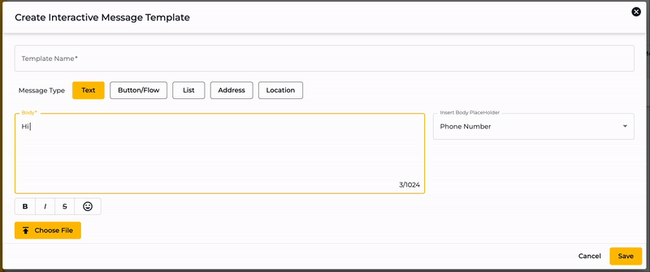
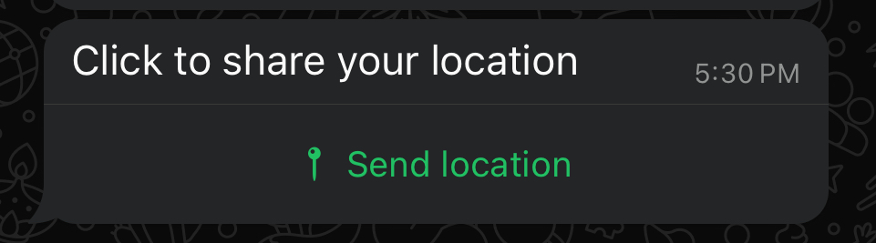
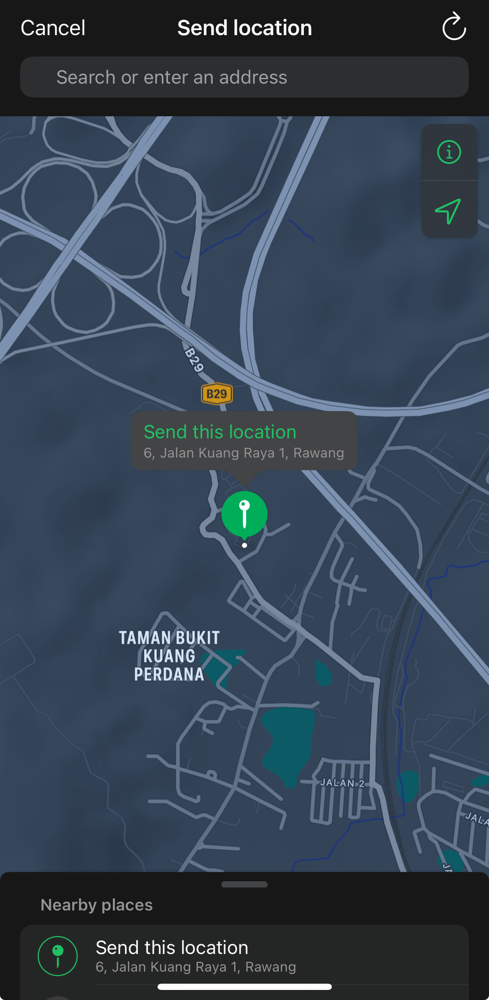

# Interactive Messages

Using the Buttons/Options/Product Messages (Interactive Messages) option in the WhatsApp channel, send pre-built interactive messages like Buttons, Lists, and Single or Multi Product messages.

To access the Interactive Message for the Cloud API WhatsApp Channel, go to **Settings** → **Channels** →  then click on the **Interactive Messages** tab under the Channel.

<figure><figcaption></figcaption></figure>

## Create an Interactive Message



Click on the **+** **Create Interactive Message** button.&#x20;

<figure><figcaption></figcaption></figure>



Upon clicking, it will open the Create Interactive Message Template builder, where you can define the template name and then select a Message Type.

<figure><figcaption></figcaption></figure>

There are a few Message Types, and upon selecting each of them, you'd get different options.

* [Text](interactive-messages.md#text)
* [Buttons/Flow](interactive-messages.md#buttons-flow)
* [List](interactive-messages.md#list)
* [Address](interactive-messages.md#address)
* [Location](interactive-messages.md#location)
* [Single Product](interactive-messages.md#single-product) (only available if you've set your Catalog)
* [Multi Products](interactive-messages.md#multi-products) (only available if you've set your Catalog)



Fill in the **Body Text** with your desired message.&#x20;

You can also use **insert** **Body Placeholder** to personalize the content dynamically.

For example, if you set your Body Text as _"Hi {full\_name}, your order is confirmed."_ When you send the Interactive Message Template, it will automatically replace the placeholder with the recipient's details, such as _"Hi **Alex**, your order is confirmed."_

<figure><figcaption></figcaption></figure>



Click **Save** once done and you will see the newly created Interactive Message appears in the list as below.&#x20;

<figure><figcaption></figcaption></figure>



## List of Message Types

There are multiple message types. By default, you will see the first 4 options only. If you have set your Catalog, you have additional option of Single Product and Multi Products options.

* [Text](interactive-messages.md#text)
* [Buttons/Flow](interactive-messages.md#buttons-flow)
* [List](interactive-messages.md#list)
* [Address](interactive-messages.md#address)
* [Location](interactive-messages.md#location)
* [Single Product](interactive-messages.md#single-product)
* [Multi Products](interactive-messages.md#multi-products)

<figure><figcaption>
Message Type Options
</figcaption></figure>

### Text

This is the standard message type with text only or text with attachment content.&#x20;

<figure><figcaption></figcaption></figure>

### Buttons/Flow

This is the message type that contains up to 3 button(s).

<figure><figcaption></figcaption></figure>

* **Header Type** - Choose to add a Text (a bolded headline before your Body text), attach an Image, Video or Document if desired.

<figure><figcaption></figcaption></figure>

* **Body Text** - Insert your body content here. You can also use **Insert** **Body Placeholder** which will get replaced with the correct information when you send the template.
* **Footer (Optional)** - Add a footer text (a smaller font size text after Body Text) if desired.
* **Buttons** - Choose to add:
  * Quick Reply - A general button option that can trigger a specific automation when clicked.&#x20;
  * Call To Action - Directs the user to an external website when clicked.
  * or WhatsApp Flow - Loads a designated WhatsApp Form when clicked.


Quick Reply button can have up to 3 options but Call to Action and WhatApp Flow button can only have 1 option.


### List

This is the message type that contains a button that loads a list of up to 10 options.

<figure><figcaption></figcaption></figure>

* **Header Type** - Choose to add a Text (a bolded headline before your Body text), attach an Image, Video or Document if desired.

<figure><figcaption></figcaption></figure>

* **Body Text** - Insert your body content here. You can also use **Insert** **Body Placeholder** which will get replaced with the correct information when you send the template.
* **Footer (Optional)** - Add a footer text if desired. This appears in a smaller font below the Body Text.
* **List CTA Label** - Enter the name of the button that will load the list options.


List CTA Label should be less than 20 characters.


* **Section Title (Optional)** - Categorize your list by adding a title for each section. Use the **+** button to add more section titles.
* **Section Row Title** - Provide a title for each option displayed to the user. Click + to add more section row.


Section Row Title should be less than 20 characters.


* **Section Row Description (Optional)** - Add a description for each option if desired.
* **Callback ID (Optional)**  - Specify an internal **ID** for the button, which can be used to trigger specific automations within the system.

<figure><figcaption>
Example of a List option with Section Title
</figcaption></figure>


You can include a maximum of **10 options** across all sections, regardless of the number of sections you create.


### Address

<figure><figcaption></figcaption></figure>

### Location

This is the message type that collect the location of your contacts.

<figure><figcaption></figcaption></figure>

**Body Text** - Enter your message prompting the user to share their location, e.g., _"Click to share your location."_ This will generate a message with a button that, when clicked, opens the user's map in WhatsApp, allowing them to easily share their location.

<figure><figcaption>
Example of a location message type
</figcaption></figure>

Once a user click on the **Send location** button, it will loads their map and they are able to choose their location to share with you.

<figure><figcaption>
WhatsApp map opened upon clicking the button
</figcaption></figure>

### Single Product

This is the message type that send a single product catalog to your contact.

<figure><figcaption></figcaption></figure>

* **Body Text** - Insert your body content here. You can also use **Insert** **Body Placeholder** which will get replaced with the correct information when you send the template.
* **Footer (Optional)** - Add a footer text if desired. This appears in a smaller font below the Body Text.
* **Add/Change A Product** - Select the single product you want to send with the message. This allow your contact to view the product's details and add to cart based on the quantity they desire.

### Multi Products

This is the message type that send multiple products catalog to your contact.

<figure><figcaption></figcaption></figure>

* **Text** - Insert a headline for your message. You can also use **Insert** **Body Placeholder** which will get replaced with the correct information when you send the template.
* **Body Text** - Insert your body content here. You can also use **Insert** **Body Placeholder** which will get replaced with the correct information when you send the template.
* **Footer (Optional)** - Add a footer text if desired. This appears in a smaller font below the Body Text.
* **Add Category (Optional)** - Click to add a category of your product(s) if desire. Click **Add Category** to add more category.
* **Add Products** - Select the product(s) you want to send with the message. This allow your contact to view the product options and its details, choose the quantity for each product, then add to cart.

<figure><figcaption></figcaption></figure>

When you send your contacts the multi product message, they interact with it like the below.

<figure><figcaption></figcaption></figure>

## How to send an Interactive Message

Through [Chat Module](../../../chat/messaging-tools.md#send-buttons-options-product-messages), you can use an interactive message easily.


[messaging-tools.md](../../../chat/messaging-tools.md)


## Edit or Delete an Interactive Message

To edit and delete a particular interactive message template,

* Click on theEdit Icon button to edit it.
* Or click on theDelete Icon button to delete the template.
