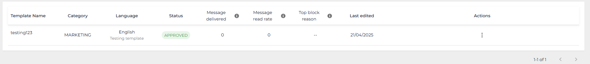
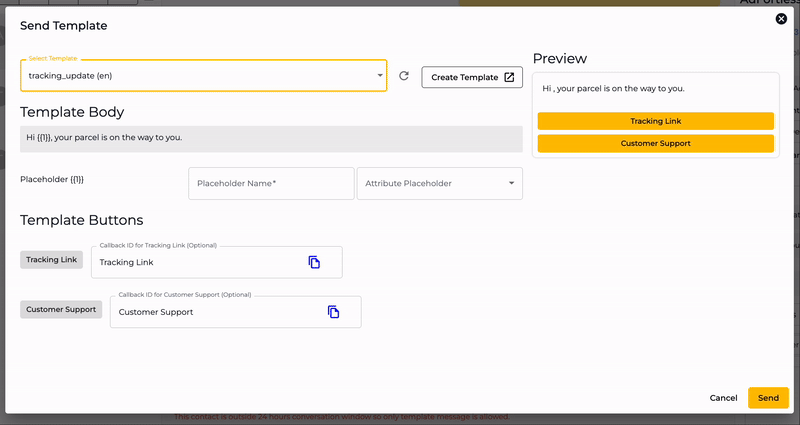

# Manage Templates



Message Templates are used to initiate a conversations after the [24-hour Customer Service Window](../../../../../useful-guides/conversation-through-whatsapp-cloud-api-1/understanding-24-hour-customer-service-window.md).

To access the Message Template for the Cloud API WhatsApp Channel, go to **Settings** → **Channels** → then click on the **Manage Templates** tab under the Channel.

<figure><figcaption></figcaption></figure>

This will open the Message Templates window.

<figure><figcaption></figcaption></figure>

<figure><figcaption></figcaption></figure>

The options available are under the .png>) :

* **Create WhatsApp Template** - Using this, you can access the builder to create a WhatsApp Message Template.
* **Synchronize with Facebook** - Sync Seampify Templates with your WhatsApp Account.
* **Delete the Message Template** 
* **Edit the Message Template** 
* **Duplicate the Message Template** 
* **Copy Template JSON** 
* **Create Automation Workflow** .png>) - You can directly create an automation based on the template message that you have setup. A more straightforward method compared to using callback IDs.\
  You may find a guide to set this up through - [here](create-automation-from-templates.md).
* **View insights**  - Hover over the template message to view the Template Analytics where you can check on the send status and read status by date range as well as the amount spen&#x74;**.**

<figure><figcaption></figcaption></figure>

## Create a Template Messages



To create a Message Template, click "+ Create Whatsapp Template" button.

<figure><figcaption></figcaption></figure>



A Create Message Template popup will come in.

<figure><figcaption></figcaption></figure>

Overview of Create Message Template popup:

* **Name -** Define Template Name. Each Template Name is unique, this means you are unable to create more than one template with the same name.
* **Category** - Select between Marketing, Utility or Authentication. [Check out Message Template to learn more.](../../../../../useful-guides/conversation-through-whatsapp-cloud-api-1/understanding-whatsapp-message-template/#types-of-message-template)
* **Language -** Choose language. Ensure you select the language in which you'll add the body text. Otherwise, it will be rejected.


You can add another language in your content, but it must not exceed 50% of the chosen language. If it does, it may be rejected.


* **Template** - Set template, choose between Standard, Catalog, Multi-product message or Carousel.
* **Header -** Select header options : None, Text, Image, Video or Document.
* **Body -** Add body text. You may use Variable that will be used as a placeholder for the template.
* **Footer (Optional) -** Set footer message.
* **Button (Optional) -** Add button options. This is mandatory for Carousel template.


Emojis cannot be used in buttons. You are unable to submit for approval if button contains emoji.



For **marketing messages**, Meta recommends adding an unsubscribe option. To do so, include this in the footer by typing: **Reply "STOP" to unsubscribe.** This will automatically remove the contact from your future broadcast list. Refer to the [Broadcast Subscription Automation Guide](../../../../automations/import-automation-template/#broadcast-subscription-automation-guide).




After adding all the details to the template, check its Preview, and if everything's fine, click **Submit For Approval**.

<figure><figcaption></figcaption></figure>



You will see the newly created template message in the page and the status will be Pending. Approval typically takes **10–30 minutes**. Once approved, you may send the template.

<figure><figcaption></figcaption></figure>



### Types of Headers in Message Template 

If you choose Header type as **Text**, you may add a bolded text before your body text.

If you choose Header type as **Image**, **Video**, or **Document**, you need to upload a sample file to help Meta verify the use. It should be a sample file, not an original Image, Video, or Document detailing your contact.

<figure><figcaption></figcaption></figure>

### Using Variable in Message Template 

If you choose add a variable, you may use it as a placeholder for the template, which you'd replace with the correct information of the contact you'll send the template to. Plus, add the variable's example in the **Sample for body content** field.

<figure><figcaption></figcaption></figure>

For instance, if you'd replace the variable placeholder with the contact's name, you can enter example content as Name to help Meta verify the use of the template and approve it.


If you set body text as, "_Hi \{{1\}}, your parcel is on the way to you_," and Example content for \{{1\}} as "_Name_," then while sending the template message to the contact, replace variable to contact's name. The template body text would be, "_Hi **Alex,** your parcel is on the way to you._"


### Footer in Message Template

If you'd like to add a Footer to the template, you can do that in the Footer Field, which is optional.


For **marketing messages**, Meta recommends adding an unsubscribe option. To do so, include this in the footer by typing: **Reply "STOP" to unsubscribe.** This will automatically remove the contact from your future broadcast list. Refer to the [Broadcast Subscription Automation Guide](../../../../automations/import-automation-template/#broadcast-subscription-automation-guide).


### Button(s) in Message Template

After the footer, you get the option to add buttons to your message template. The template support adding two types of buttons: **Call to Action** and **Quick Reply**.

<figure><figcaption></figcaption></figure>

The Call to Action button lets you further add 2 buttons:

* **Call Phone Number** - direct user to call the number using telco line from their mobile.
* **Visit Website** - direct user to an external website.

<figure><figcaption></figcaption></figure>

And the Quick Reply button lets you add up to 10 buttons for the selected purpose.

<figure><figcaption></figcaption></figure>

## Sending a Message Template

There are 3 ways to use a message template,

1. Using [Chat](../../../../chat/messaging-tools.md)
2. Using [Drip Campaign](../../../../drip-campaign/create-a-drip-campaign.md)
3. And using [Campaign](../../../../campaigns/bulk-broadcast-via-campaign.md)

While using the template through one of the above methods, ensure you replace the variable with the correct information. Simply select the **Attribute Placeholder** to replace the variable. And once you send the template, the message will pick the correct information, and it will look like the following.

<figure><figcaption></figcaption></figure>
