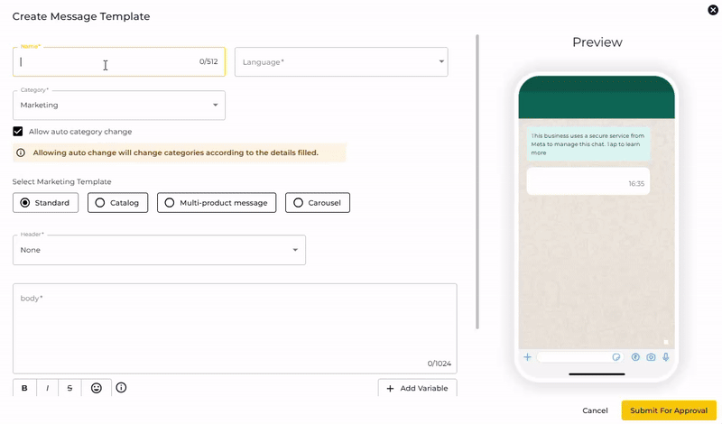

# Carousel Template

### Accessing Carousel Message Template

* **Navigate to**: Settings → Channels.
* **Manage Templates**: Click the "Manage Templates" tab under the Channel section.

<figure><figcaption></figcaption></figure>

### **Creating a Carousel Message Template**

* **Click**: "+ Create WhatsApp Template" button.

<figure><figcaption></figcaption></figure>

* A popup will appear for creating the template.

<figure><figcaption></figcaption></figure>

**Template Details**:

* **Name**: Enter a unique template name (duplicate names are not allowed).
* **Category**: Select one from Marketing, Utility, or Authentication.
* **Language**: Choose the language matching the body text content.

### Setting Up Carousel Template

1. **Select**: Carousel as the template type.
2. **Body**: Add the text (Mandatory)
3. **Card Setup**:
   1. **Click on a Card**: To create the carousel.
   2. **Upload**: Image or video for each card.
   3. **Customize**: Body text for each card or product.


break lines are not supported in carousel body text


<figure><figcaption></figcaption></figure>

4. **Add Button**:
   1. **Type**: Choose Custom or Call to action (Mandatory).
5. **Additional Cards**: Add more cards or products as needed (Maximum 10 cards)
6. **Submit for Approval:**
   1. Once everything is set, submit the template for approval.

<figure><figcaption></figcaption></figure>

## Carousel Template Specifications

Before creating your Carousel Template, make sure your content meets the following requirements.

<table data-search="false"><thead><tr><th>Component</th><th>Specification</th></tr></thead><tbody><tr><td>Number of Cards</td><td>2–10 cards</td></tr><tr><td>Card Media</td><td>Image OR Video</td></tr><tr><td>Media Format</td><td>All cards must use the same media type</td></tr><tr><td>Image Format</td><td>JPG / PNG</td></tr><tr><td>Maximum Image Size</td><td>5 MB</td></tr><tr><td>Recommended Image Size</td><td>1125 × 600 px</td></tr><tr><td>Recommended Aspect Ratio</td><td>1.91:1</td></tr><tr><td>Video Format</td><td>MP4</td></tr><tr><td>Maximum Video Size</td><td>16 MB</td></tr><tr><td>Card Body</td><td>Maximum 160 characters</td></tr><tr><td>Buttons per Card</td><td>1–2 buttons</td></tr><tr><td>Supported Buttons</td><td>URL, Phone Number, Quick Reply</td></tr><tr><td>Message Body</td><td>Maximum 1,024 characters</td></tr></tbody></table>

#### Important

All cards within the same Carousel Template must maintain a consistent structure.

For example, if Card 1 contains:

* Image
* Body text
* URL button
* Quick Reply button

then the remaining cards should use the same component structure.

