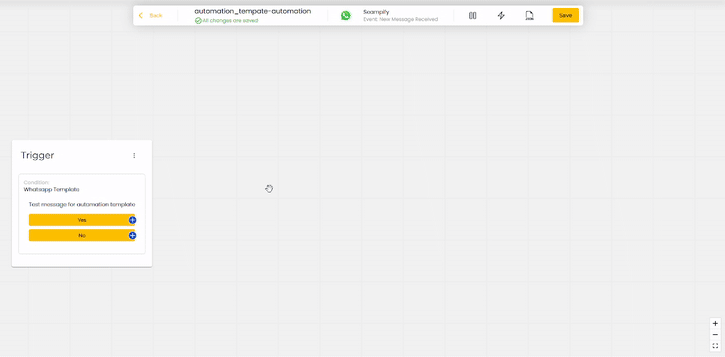

# Create Automation from Templates



Here is a step by step guide on how to create an automation straight from Manage Template module.

## Accessing Message Template

* **Navigate to**: Settings → Channels.
* **Manage Templates**: Click the "Manage Templates" tab under the Channel section.

<figure><figcaption></figcaption></figure>

## **Creating a Message Template**

* **Click**: "+ Create WhatsApp Template" button.

<figure><figcaption></figcaption></figure>

* A popup will appear for creating the template.

<figure><figcaption></figcaption></figure>

**Template Details**:

* **Name**: Enter a unique template name (duplicate names are not allowed).
* **Category**: Select one from Marketing, Utility, or Authentication.
* **Language**: Choose the language matching the body text content.

### Setting Up Template

1. Select **Standard** as the marketing template.
2. **Body**: Add the text (Mandatory)
3.  **Add Button**:

    **Type**: Choose Custom (Mandatory).
4.  **Submit for Approval:**

    Once everything is set, submit the template for approval.

<figure><figcaption></figcaption></figure>

## Creating the automation

1. Once your template message is approved. Click on the 3 dots on the right under **Actions** and select "Create Automation workflow".

<figure><figcaption></figcaption></figure>

2. You will be brought to the automation screen with the trigger node being the template message itself. The name of the automation is based on your template message name. You may start building your automation from the trigger node directly.

<figure><figcaption></figcaption></figure>
