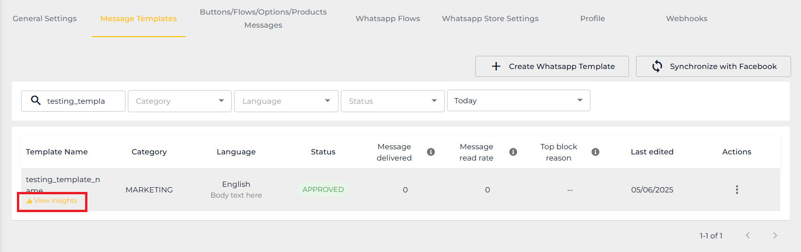

# How to view Template Insight

Template Insight is a function for you to check and analyze the performance of your template message. You can see this by navigating to **Manage Template.**&#x20;

### How to access the Template Insight

Step 1: Choose the template message you want to check.

Step 2: Hover over the template message name until you see **View Insight** and click on it. You will be direct to the Template Insight page.

<figure><figcaption></figcaption></figure>

### Functions in Template Insight

<figure><figcaption></figcaption></figure>

1. **Template Message Name** - This shows the name of your template message, the category, the approval status and the last updated date.
2. **Template Message Preview** - This shows the preview of how your message template is seen by your customer.
3. **Duration** - You can change the duration you want to check for the template message.
4. **Cost** - This will show the cost of the template message used during the duration.
5. **Performance** - This will show the statistics of the template message being sent, delivered, read and replies.
6. **Button Click** - This function can track if the customer has interacted with the template message. However, this can only track for Custom Reply button. CTA buttons will not be tracked as they are going to external communication.
