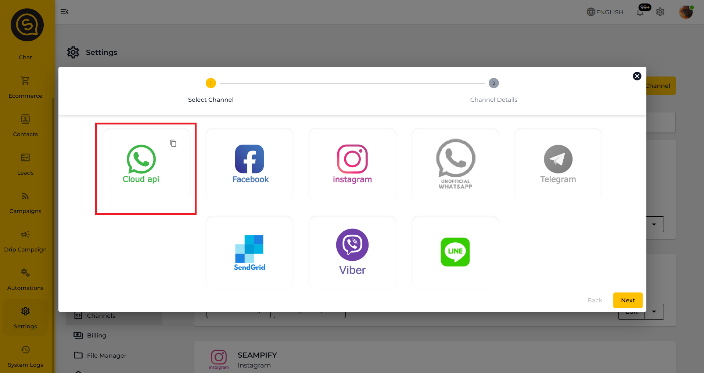
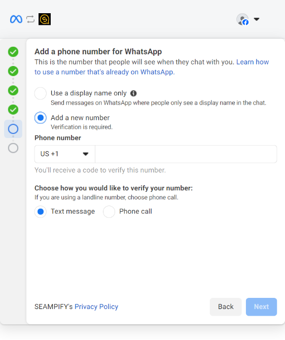

# Connecting Multiple Numbers in Seampify

You can have multiple numbers to be connected with the same Seampify account. You may onboard with WABA with a [completely new number,](../../../../starting-with-seampify/connecting-to-whatsapp-cloud-api/) or [onboard with Meta Co-Existence](../../../../starting-with-seampify/connecting-to-whatsapp-cloud-api/onboarding-whatsapp-business-app-users-coexistence.md).

## Things to prepare

Here are a few things you need to prepare before getting a WhatsApp Business Platform (API) account:

* A new Phone Number - [refer here on choosing a phone number](../../../../useful-guides/whatsapp-api-business-account/choosing-a-phone-number.md)
* The admin of your Meta Business Portfolio (MBM)
  * [Click here to check if you have a business portfolio and how to create one if you didn't have](../../../../starting-with-seampify/connecting-to-whatsapp-cloud-api/create-a-business-portfolio.md#steps-to-create-a-business-portfolio)
  * [Make sure you are the admin of the business portfolio](../../../../starting-with-seampify/connecting-to-whatsapp-cloud-api/how-to-check-if-you-are-an-admin-of-your-business-portfolio.md)
  * Ensure that your business adheres to the [WhatsApp Business Messaging Policy](https://www.whatsapp.com/legal/business-policy/?fbclid=IwAR0r5k_N1rCYnfK8yyCWUP3D88tVCR814x9UX-w5EIcu8ai8b8is8ilrAQY).

## Connecting to WhatsApp Cloud API

If you wish to onboard with Meta Co-Existence, refer to the guide:


[onboarding-whatsapp-business-app-users-coexistence.md](../../../../starting-with-seampify/connecting-to-whatsapp-cloud-api/onboarding-whatsapp-business-app-users-coexistence.md)


If you wish to onboard with WhatsApp Cloud API, refer to the below steps:

### _Step 1: Access the settings page_

Click on the settings tab on the left, you should be brought to the channels page.

Click on the top right button that says "**+ Create Channel**"

<figure><figcaption></figcaption></figure>

Then, select on WhatsApp Cloud API

<figure><figcaption></figcaption></figure>

### _**Step 2: Whatsapp Cloud API Pop Up**_

* Select **"I want to create a new WhatsApp Business API."**
* Click the **"Login with Facebook"** button to proceed.

<figure><figcaption></figcaption></figure>

### _**Step 3: Login to Facebook**_

* Log in to your Facebook account that are the [**admin** of the associated Business Portfolio.](../../../../starting-with-seampify/connecting-to-whatsapp-cloud-api/how-to-check-if-you-are-an-admin-of-your-business-portfolio.md)

<figure><figcaption></figcaption></figure>


* You must be an **admin** of the Facebook Business Portfolio.
* Only admins have the permissions required to create WhatsApp API Business Accounts.


* Grant necessary permissions to **Seampify**.
* Follow the on-screen instructions to complete the connection process.

<figure><figcaption></figcaption></figure>

### _**Step 4: Fill in Business Information**_

* Choose your **business portfolio**. If you do not have a business portfolio, you may create a new one.
* Complete the required fields, such as business name and a valid website.
* 

<strong>What is a valid website?</strong> <strong>-</strong> Viewable and belongs to your business <strong>-</strong> Contain informations that can determine your business industry - Has a matching email domain and web address - Features your company's name or logo.  Having a valid website in your MBM serves as a best practice to prevent any potential issues if and when you want to apply for <a href="https://www.facebook.com/business/help/2058515294227817?id=180505742745347">Meta Business Verification</a>.

* Click **Next** to proceed.

<figure><figcaption></figcaption></figure>


Note: Enter a valid business website as Facebook uses the website information to check compliance with [WhatsApp's Commerce Policy](https://business.whatsapp.com/policy)


### _Step 5: Select WhatsApp Number_

* Select " **Start with a new WhatsApp phone number**" for the prompt.
* Click **Next** to proceed.

<figure><figcaption></figcaption></figure>

#### <mark style="color:red;">Note!</mark> Please do not choose "Connect your existing WhatsApp Business app" as this feature has not been publish in Seampify yet.

### _**Step 6: Create a WhatsApp Business Account (WABA)**_

* Select **"Create a new WhatsApp Business Account"** for both prompts.
* Click **Next** to proceed.

<figure><figcaption></figcaption></figure>

### _**Step 7: Fill in WhatsApp Business Account (WABA) Details**_

Enter the following details:

* **Whatsapp Business Account Name:** Used for internal reference in your business portfolio.
* **Whatsapp Business Display Name:** The name that will appear on your WhatsApp profile to customers.

Click **Next** once the details are filled in.

<figure><figcaption></figcaption></figure>

### _**Step 8: Verify WhatsApp Number**_

* Select the option "Add a new number".&#x20;
* Enter the **phone number** you wish to connect to the WhatsApp Business API. Then, pick the choice to retrieve the OTP for verification.


- You will need to **delete your WhatsApp account** in the WhatsApp Messenger / WhatsApp Business app (not the app itself) before proceeding. [Refer here for detailed instructions on how to delete your account.](../../../../useful-guides/whatsapp-api-business-account/how-to-delete-whatsapp-account-on-mobile-app.md)



Deleting your account will erase all conversation history. Contact Seampify's Customer Support if you wish to migrate the conversations to Seampify platform.


<figure><figcaption></figcaption></figure>

* Click **Next** to generate an OTP for verification.

<figure><figcaption></figcaption></figure>

### _**Step 9: Complete the Setup**_

* Once the verification is complete, you can add a payment method immediately or do it later.
* If you wish to skip, select **"Finish"**, and you will be redirected to Seampify.

<figure><figcaption></figcaption></figure>

* On the Seampify dashboard:
  * Select **Add Channel**.
  * Click **Finish** once the channel has been successfully added to finalize the setup.

<figure><figcaption></figcaption></figure>


Ensure you click the **Add Channel** button before finishing. Failing to do so may require you to redo the setup process


## Completed connection of multiple numbers.

<figure><figcaption></figcaption></figure>

Once completed the connection of the number(s), the numbers will appear in a list like the image above.

You will also see multiple WhatsApp numbers on the Chat page like this:

<figure><figcaption></figcaption></figure>
