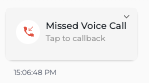

# Answering Call from Seampify

To answer call from Seampify, you will need to setup an automation for this.

## Setting Up Automation for Incoming Call



### Go to Automation and create a New Automation

Select **New Voice Call** for the Event, click **Create**.

<figure><figcaption></figcaption></figure>



### Choose the Forward Call nodes

Once you are in the **Automation** window, go to the **menu** and select on the **Forward Call** node.

<figure><figcaption></figcaption></figure>



### Setup Forward Call setting

Double click on the node to open the settings and setup accordingly.

<figure><figcaption></figcaption></figure>



### Click Save once done.



## Answering Call from Seampify

Once a call is established from your customer, it will assigned to the agents based on the settings setup in the automation. The agent's Seampify account will have a notification to Answer, Message or Decline the call.

<figure><figcaption></figcaption></figure>

Once a call established, you may see the call status from the Chat page:\
.png>)

*  : Click this to mute and unmute your mic
*  : Click this to open the conversation chat page to message the customer
*  : Click this to terminate the call

Once you have terminated the call, you will be able to see the below status with the voice recording of the call.

.png>)

You can also view from the Settings > Call Logs and export from there.

<figure><figcaption></figcaption></figure>

If you have missed a call, you will be able to see the below status and a button to callback using [Business-Initiated Calls](business-initiated-calls.md)

<figure><figcaption></figcaption></figure>


When a WhatsApp user calls you, regardless of if you accept the call or not, they will give you a temporary call permissions **for 7 calendar days (168 hours).**

