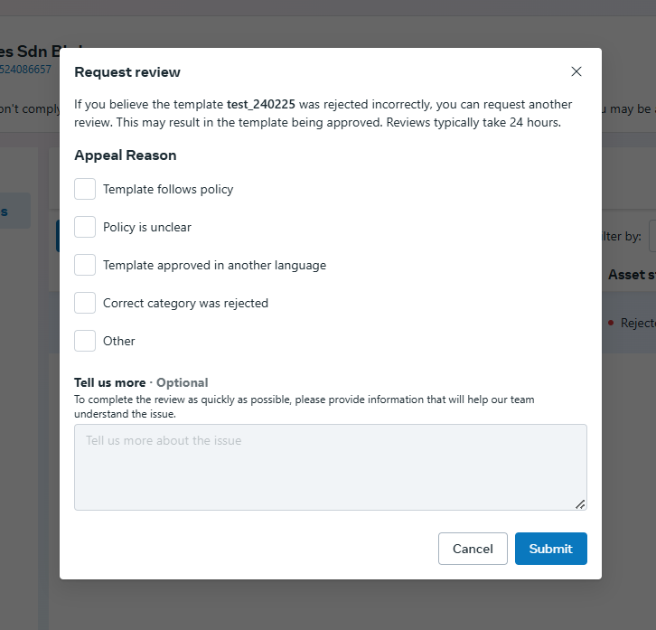

# Troubleshoot Template Message Rejection

### Steps to troubleshoot template message rejection

Follow these steps to check why your message template was rejected by Meta.

**Step 1:**

Go to [Business Support Home](https://www.facebook.com/business-support-home) in your Meta Business Account. Select the WhatsApp Business Account used to submit the message template.

<figure><figcaption></figcaption></figure>

**Step 2:**

Click **Rejected Message Templates** to view the rejected templates and their rejection reasons.

<figure><figcaption></figcaption></figure>

Below are some common rejection reasons and how to resolve them.

<table><thead><tr><th width="218">Policy Issue</th><th>Action Required</th></tr></thead><tbody><tr><td>Category Mismatch</td><td>Refer to <a href="message-templates-example.md">Message Templates Example</a>. If you believe the category is correct, request a review. Otherwise, revise the template according to Meta's suggested category.</td></tr><tr><td>Shortened URL</td><td>Avoid using URL shorteners. Use the full destination URL instead.</td></tr><tr><td>Misleading</td><td>Templates may be rejected for misleading, restricted, or prohibited content, including certain financial services, deceptive business models, or inappropriate health-related claims. Review and revise the content according to <a href="https://whatsappbusiness.com/policy/?utm_source=chatgpt.com">WhatsApp Business Messaging Policy</a>.</td></tr></tbody></table>

### How to Appeal a Rejected Template

If you believe your template was rejected incorrectly, you may request a review through Meta Business Support Home.

**Step 1:**

Select the rejected message template and click **Request Review**.

<figure><figcaption></figcaption></figure>

**Step 2:**

Select the appropriate appeal reason and click **Submit**.

<figure><figcaption></figcaption></figure>

**Note:** The Request Review option may not be available for certain rejection reasons, such as invalid template formatting. In those cases, correct the template and resubmit it for approval.
