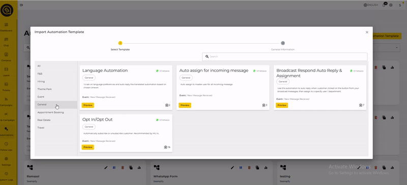

# Why I Didn't Receive Notification on Seampify App

## 1. **Verify You're Logged In**:

* Ensure you're logged into your Seampify account within the app. Notifications are only sent to authenticated users.

## **2. Check App Notification Settings**:

* **On Your Device**:
  * **For iOS**:
    * Go to `Settings` > `Notifications`.
    * Scroll to find the Seampify app.
    * Ensure 'Allow Notifications' is toggled on.
  * **For Android**:
    * Navigate to `Settings` > `Apps` or `Application Manager`.
    * Locate the Seampify app in the list.
    * Tap on it and select 'Notifications'.
    * Ensure notifications are enabled.

## **3. Assign User to Chat Using Automation**

Follow these steps to automatically assign conversations to users and receive notifications:

1. **Go to Automation:**
   * Navigate to **Automation** in your app.
2. **Import Automation Template:**
   * Click on **Import Automation Template**.
   * Choose **Opt-in/Opt-out** from the list of templates.
3. **Assign to Team Member:**
   * Click on **Assign to Team Member**.
   * Set the **Assignment Type** to **Assign to Specific Team Member**.
   * Choose **Your Name** as the team member.
4. **Import the Template:**
   * Click on the **Import** button to apply the automation.

<figure><figcaption></figcaption></figure>

For more details on setting up automations, refer to the [Seampify Automation Guide.](../../seampifys-modules/automations/)

## **4.  Manually Assign User to Chat**

If you prefer to manually assign users to chats, follow these steps:

1. **Go to Chats:**
   * Navigate to the **Chats** section in your app.
2. **Select Any Chat:**
   * Click on any chat you want to assign.
3. **Assign Agent:**
   * In the right panel, click on **Assigned Agent**.
   * Click on **Your Name** to assign yourself to the chat.

Once assigned, any new incoming message to this conversation, a notification should be triggered on your Seampify app.
