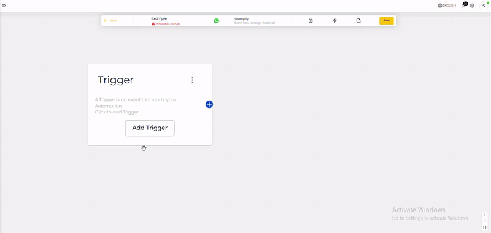
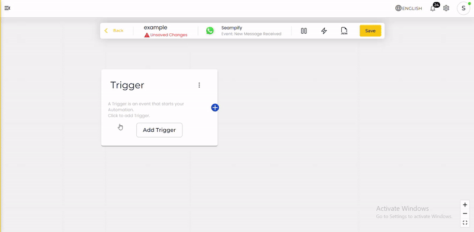

# Why is My Automation Not Working?

## **1. Make Sure the Automation is Played**

* The first step is to ensure that the automation has been played.
* **Action**: Click the "Play" button to start the automation.

<figure><figcaption></figcaption></figure>

* The automation won’t run unless it's activated manually.

***

## **2. Check the Trigger Node**

The trigger node is critical for determining when the system should perform automation.&#x20;

<figure><figcaption></figcaption></figure>

Ensure it is configured based on the **condition you want to use** and apply it accordingly. Follow these steps to ensure the trigger node is set up correctly:

* **To perform automation triggered by ads**:
  * Ensure to use  `Custom Condition`

<figure><figcaption></figcaption></figure>

*   **To automate actions triggered by button clicks:**

    * **Set the Callback ID for Buttons**

    <figure><figcaption></figcaption></figure>

    * Ensure the callback ID in the button of template matches the callback ID in the automation.

    <figure><figcaption></figcaption></figure>
* **Handle  First or After-24-Hour Messages**:
  * This trigger node will play automation when:
    1. There is a **new incoming message** from the customer for the first time.
    2. There is an **incoming message after the 24-hour chat window** has expired.

<figure><figcaption></figcaption></figure>


**Note**: Automation will not run if the first message is initiated by you. The system only works if the customer sends the first message.


*   **Ensure Keyword Matches**:

    * The **keyword exactly matches trigger node** will only perform automation when the system detects incoming messages that exactly match the specified keywords.

    <figure><figcaption></figcaption></figure>
