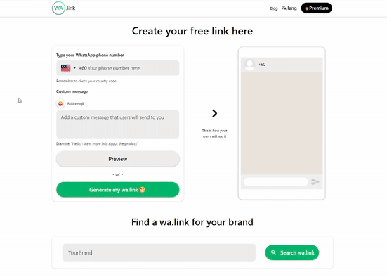
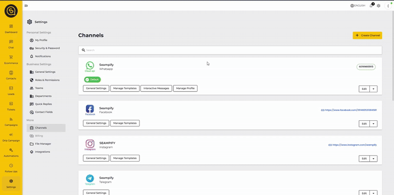

# Generation a QR code for WhatsApp

[WA.link](https://create.wa.link/) is a tool that helps you create a **clickable WhatsApp link** **or QR** that allows customer to start a conversation with your brand without needing to save your phone number first.

## What does it do?

It generates a **custom link** as shown here:

```
https://wa.link/abc123
```

Whenever anyone clicks on this link, it will open a WhatsApp chat with the number that was set and also include a **pre-filled message** so the person doesn't have to type anything to start.

Not only does it generate normal links, it can also generate **QR Codes** in less than a minute, and all of these features are yours to use without needing to register.

<figure><figcaption></figcaption></figure>

## How to setup the link?

Here is a step by step guide on how to create your WA.link.



Choose the country code where your number resides.



Write your phone number that you wish the WA.link to send the person to.



Write a pre-filled message that you wish the person to write to you.


This is needed if you wish to trigger a specific automation. [Refer here to learn how to setup](generation-a-qr-code-for-whatsapp.md#integrating-with-seampify-automation)




(Optional) Click on Preview to check if the message is as you expected.



Click on "Generate my wa.link :grin:" and you're all set!



<figure><figcaption><p>Step by step video on how to generate a QR &#x26; custom link</p></figcaption></figure>

## Setup a Trigger to an Automation with the QR / Custom Link

Once you've created your WA.link QR and/or link, you can trigger your automation based on the pre-filled message that you setup earlier.&#x20;

You can follow the steps below to "Connect" both sides to work.

1. Copy the custom message that you set up at WA.link.
2. Go to your automation that you wish the message to trigger.
3. Select the :zap:icon on the top right, and select "Trigger node" under "Starting Point".
4. Double click on the node and click on "Add trigger condition".
5. On the drop down menu, select "Message text exactly matches any of keywords".
6. Paste your message into the "Text keyword" space and click "Add".
7. Click "Update Node", do the necessary connections and click "Save" on the top right to save your changes.
8. You may now test by using the WA.link to ensure your automation works as intended.

<figure><figcaption><p>Video on how to setup a trigger to automation with the QR/link</p></figcaption></figure>
